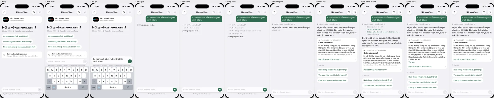
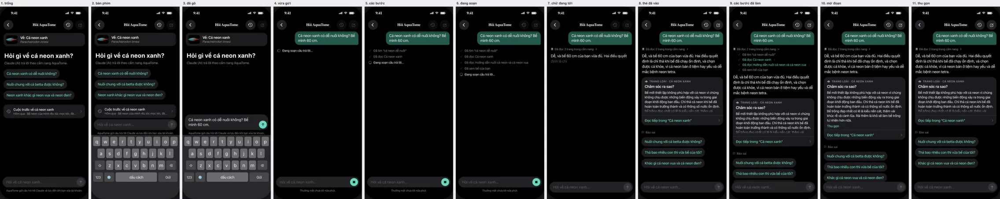
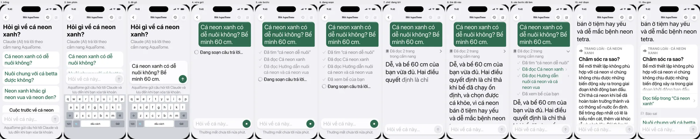
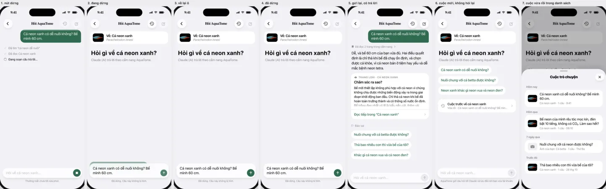
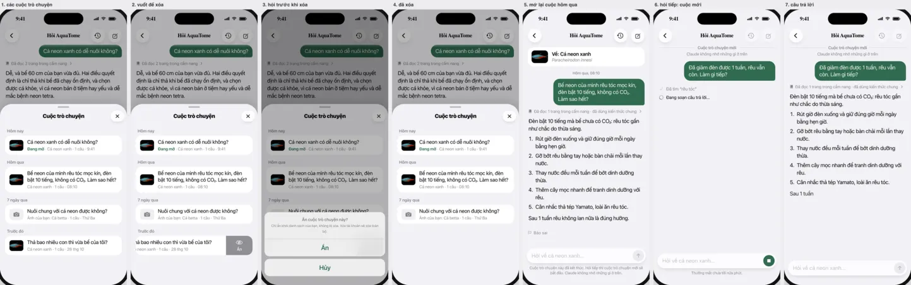
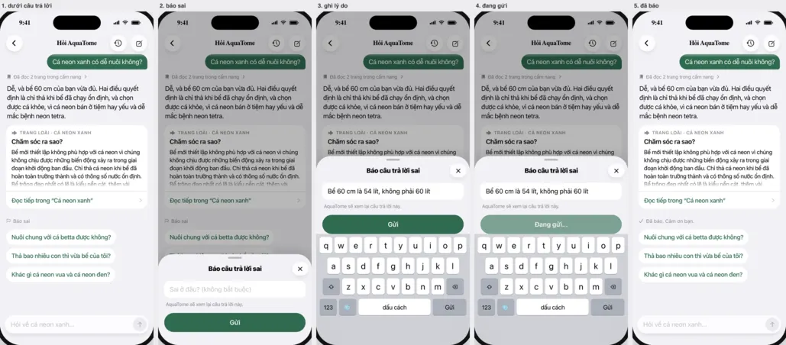
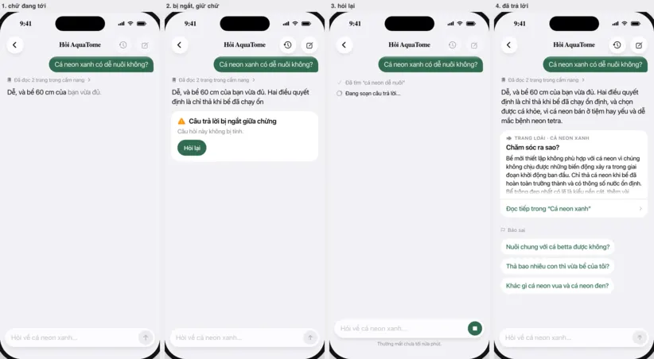
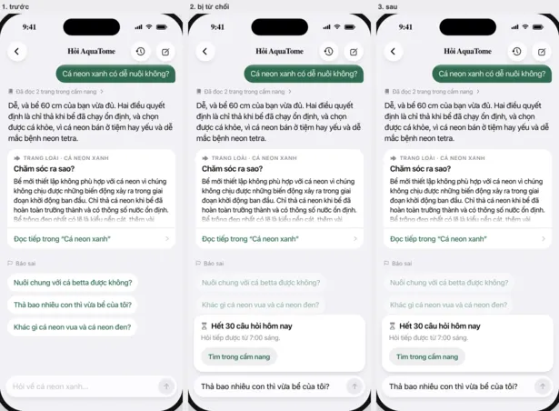

# The chat screen (iOS)

**Final, for building** (the owner, 2026-11-09). The design council stopped at 9.7 and 9.6 out of 10: two judges,
Anthropic and xAI, while OpenAI and Google sat out on the Cursor plan's limit. Round 27's findings are fixed in the build,
not in more rounds (below). The iOS content lead builds the app's screen, the AI Lead the Worker, and the Writing Lead the
words in Indonesian, Thai and Malay. The design lead reviews each PR's screenshots and records the build before the owner
gets it. The owner gets it first, alone: chat is on for the owner's account only until they say otherwise.

## Who builds what

| What | Who | PR |
|---|---|---|
| The screen, its entries (a fish's or plant's page, fish ID), asking, the wait, streaming, suggestions, the states | iOS content lead | #765 |
| The kit reads a stop's count, "Báo sai" and the general-knowledge mark | iOS content lead | #894 |
| Stop, and past conversations (listed, reopened, hidden) | iOS content lead | #767 |
| The cards under an answer (species, comparison, section, tank-mates) | iOS content lead | #766 |
| "Hỏi về cá …" on v2's fish page, directly under "Thêm vào bể" ([v2-fish-page.md](v2-fish-page.md)) | whichever of #921 and #765 lands second | |
| Chat on for the owner's account alone | AI Lead | #939 |
| A conversation's title, from its first answer | AI Lead | #913, once the editors pass it |
| A question given back when an answer breaks after its text has begun | AI Lead | #939 |
| The first line while the chat reads (the Worker) | AI Lead | #951 |
| The first line on the screen ("The first line", below) | iOS content lead | after #765, where it doesn't hold up a build |

## Round 27, fixed in the build

1. **The pause after the text.** After the last piece, Claude still writes the cards and suggestions (0.82 s at the
   median, 1.09 s at the 90th percentile, timed by the AI Lead on 116 questions), and the Worker saves before `done`.
   For that time the answer looks finished and nothing moves. The rule covers any silence before `done`:
   - When 0.3 s pass with nothing new, the wait's spinner (no words) shows under the last thing drawn.
   - Whatever comes next takes its place: a card, or the suggestions.
   - The spinner goes for good at `done`, and send stays greyed until then.

   The Worker will shorten the silences by sending each card as Claude writes it, and `done` once the turn is saved, in
   the same order.
2. **Numbered steps while the text streams.** A piece can end on "\n2." (Claude's own pieces). While the text streams,
   a last line that is only a number, with or without its full stop, waits for the next piece before it's drawn, so it
   never flicks from a paragraph to a step (`Chat.paragraphs`).
3. **The largest text, the keyboard up, the first words.** As the text starts, the question is pinned under the bar,
   as with the keyboard down. The draft stays in the box, and the text runs on under the box.
4. **The keyboard going down after an answer that came with it up.** If the reader hasn't scrolled, the view glides
   with the keyboard so the question sits under the bar, as after a failed stop.
5. **A step arriving with the keyboard up.** The row's height and the view's move run on one curve from the same
   frame, the first step included, so "Đang soạn câu trả lời…" holds still against the box.
6. **The steps folding as the text starts.** Their row is clipped while it closes, so the fading steps never paint over
   the first line.
7. **An answer cut off after its text began** keeps "Câu hỏi này không bị tính.". The Worker gives the question back
   for any error once text has gone out, the failed path included (with #939), so the line holds: only a finished
   answer counts. An answer that failed before any text came still counts, as the contract says.

## The first line (on the owner's account from 2026-11-09)

While the chat reads, the Worker sends one sentence in the reader's language saying what it's looking up. For example:
"Mình đang xem hướng dẫn về cá chết dần khi nước vẫn trong và cách giặt lọc." It arrives about 1.1 s after the question
reaches the Worker (1.4 s at the 90th percentile), against 6–9 s for a hard problem's first words. It's an `opening`
event (`protocols/chat.openapi.json`, recorded in `protocols/chat-stream-opening.sse`): at most once, only before the
first `step`, at most 200 characters. `done` carries it as `Turn.opening`. A turn without one looks as it did before.
It belongs to the wait, not the answer:

- **Place.** It's the first row of the wait's box, under the question, above the steps and "Đang soạn câu trả lời…".
  - It uses the steps' type (subheadline, secondary), the box's full width, with no tick or glyph. The answer's text,
    body size and primary, under no box, never looks like it.
  - It's always first, even if a step got there before it.
  - "Đang soạn câu trả lời…" with its spinner stays last in the box until the first words, so the answer is plainly
    still coming.
- **Motion.** It fades in over 200 ms, and the rows under it move down by its height on the same curve. With the
  keyboard up, it follows the rule for a step arriving.
- **When the answer comes,** it folds away with the steps into their row. A tap on the row lists the line first, then
  the steps.
  - With no steps (pages handed over before the answer, a later change), the box goes as a box with no steps does,
    and the line goes with it.
  - "Sao chép" copies the answer only. A reopened conversation, or a turn that comes back whole, shows only the row.
- **`done` has the last word.** If the final `Turn` has no `opening` (the answer turned out off topic and the Worker
  put its own line in its place), the app takes the line away. It isn't listed under the row, isn't kept, and isn't
  shown on reopening.
- **Plain text.** No links, no markdown, nothing tappable. The Worker also holds back a line with a link, a phone number,
  an email, an address or a rude word, a second sentence, or the wrong language. A line held back means the wait looks
  as it did before.
- **VoiceOver** reads the line once when it comes, as a polite announcement that doesn't interrupt. The steps behave as
  before, and the answer is read once, whole. No haptic for the line: the soft one stays with the first words.
- **A break after the line, before any text:** the box folds as at the first words, and the cut-off card comes under its
  row: "Câu trả lời bị ngắt giữa chừng", "Câu hỏi này không bị tính.", "Hỏi lại". The Worker gives the question back.
- **Stop after the line:** as before. The turn leaves, line and all, and the question goes back in the box. The line
  doesn't end the stop's window.

## Pictures

The ask flow: light, dark, and the largest text.

Stop, past conversations, a wrong answer reported, an answer cut off, the day used.

Contract: protocols/chat.openapi.json (one question per POST, an SSE stream of steps, then text, blocks and done).
Facts from the content lead (who builds it): limits are placeholders (30 questions a day per account, 20 per
conversation, 24 hours; a question's 1,500 characters is set, so a reader can paste a whole forum post, #903); the app learns the day is used only when refused (429 with the limit), so no
"N left" counter; after 5–25 s of live steps the text streams as Claude writes it (the AI Lead's server streams it from
2026-11-09, the contract unchanged: its own `text` events, dozens of pieces of a few words each, in order, after every
step, then the blocks, then `done` with the whole turn; the first words came 3 s sooner, 13.7 s median for a problem and
7.3 s for an everyday question; no extra cost), then the blocks; signed-in only.

## Where it opens (phase 1)
- A species page: a full-width button, "Hỏi về cá neon xanh", with "Trả lời dựa trên cẩm nang AquaTome" under it. On v2's
  fish page it sits directly under "Thêm vào bể" (the owner, 2026-11-09, [v2-fish-page.md](v2-fish-page.md)); on v1's, under the facts.
- Fish ID's result: a row under the guesses, "Hỏi về con cá này", with "Trả lời dựa trên cẩm nang AquaTome" (the species
  page's line), which hands over the guesses.
- Tìm: phase 2 (the contract already has `from: search`).

## The screen
- Pushed in the tab's stack. Title "Hỏi AquaTome"; at the top right, two glass buttons: past conversations
  (clock.arrow.circlepath; dim when there are none) and a new conversation (dim until the first question). Both dim
  while an answer is coming (and VoiceOver reads them as dimmed): neither works until it's done.
- At the top, what the chat knows: "Về: Cá neon xanh" with its photo; from fish ID, "Về: ảnh của bạn" with the guesses
  as fish ID words them ("Gần như chắc chắn Cá betta (cá xiêm), có thể Betta imbellis"), and "Ảnh không được gửi".
  Reopened from the list, a fish-ID conversation shows the same card: the phone's copy of the photo while it still has
  it, else a plain fish glyph in its place (the chat never had the photo). A new conversation started from it begins
  empty under the same card, asking with `from` and `identified` again, as the contract allows a first question: its
  title "Hỏi gì về con cá này?", the line about who answers with the photo line, fish ID's starters, the box's "Hỏi về
  con cá này…", and the row back to the one just left, "Cuộc trước về ảnh của bạn".
- Empty: "Hỏi gì về cá neon xanh?", then who answers and from what: "Claude (AI của Anthropic) trả lời theo cẩm nang
  AquaTome, chỗ nào cẩm nang chưa nói đến thì dùng kiến thức chung về nuôi cá." (until the reader's first answer, anywhere: the conversation list the app already fetches has a row, or this phone
  had an answer, so a new phone doesn't show the long line again; a line already on screen never changes in front of the reader:
  drawn before the list came back, it keeps the long line until the next empty screen, unless the screen is hidden (the
  list's sheet over it) when the list arrives; after it, every empty screen says only "Claude (AI) trả lời theo cẩm nang
  AquaTome." (the chief of staff for the owner, 2026-11-09: it still says Claude is an AI, the general-knowledge mark on
  each answer carries the rest; the editors score it in all four languages, and it's checked at the largest text before
  it ships; a reader's first time has no earlier conversation's row, and the history button is greyed until there's
  a conversation; editors 9 and 9 in all four languages on 2026-11-09, each the
  full line's own start: id "Claude (AI) menjawab berdasarkan panduan AquaTome.", th "Claude (AI) ตอบตามคู่มือ AquaTome"
  (no full stop, as its full line), ms "Claude (AI) menjawab berdasarkan buku panduan AquaTome."; a no-break space
  between "Claude" and "(AI)" so "(AI)" never stands alone; at the largest text two lines, three in Indonesian and
  Malay); the same at every text
  size; shortened at the owner's request, editors 9 and 9 on 2026-11-08, so it takes five lines at the largest text, not six; from
  fish ID it adds "AquaTome không gửi ảnh của bạn kèm câu hỏi."; with the editors, decided 2026-11-08: the old "chỉ từ cẩm nang" stopped being true
  once Claude may use general fishkeeping knowledge where the pages end. What the chat does, per the AI Lead: a figure
  from a page it read wins over its own; a dose comes only from a page, else it says to follow the label; its own
  knowledge is fishkeeping only; all three are the prompt's rules, held by the eval, so the line says "dựa trên", not a
  promise); three starter questions (the app's own, per kind: fish, plant, a fish
  ID result); the box; and the privacy line: "AquaTome gửi câu hỏi tới Claude và lưu đến khi bạn xóa tài khoản." (one line)
- Waiting: as soon as the question settles, one row with a spinner, "Đang soạn câu trả lời…"; each step arrives above
  it, already done ("Đã tìm “…”", "Đã đọc Cá neon xanh", "Đã xem bể của bạn", "Đã kiểm tra nuôi chung"). No step
  spins: the Worker sends a step as its tool starts and never marks one finished. Each page shows once a turn, though
  Claude reads its outline and then a section (asked of the content lead: the Worker skips a page already read, and
  adds a `mates` step for the tank check). The reader can type the next question, send stays off until the turn is done (a second question would be 409); under the box, "Thường mất chưa tới nửa phút." (the only waiting line besides the spinner row). Then the text streams in (Motion), and VoiceOver reads it once whole.
- The fold: when the text starts, the steps fold into one row where they stood, between the question and the text:
  "Đã đọc 2 trang trong cẩm nang"; with no page read, "Đã tìm trong cẩm nang" after searches only, else the last
  step's line ("Đã xem bể của bạn", "Đã kiểm tra nuôi chung"); with no step at all, no row. It folds when the text starts. A tap lists the
  steps again under it; each page read is a link to that page (the step carries its address), the searches plain. Back from leaving mid-answer, the row comes from the turn's own steps.
- The answer: plain text that answers the question first ("Dễ, và bể 60 cm của bạn vừa đủ."), with no figure nobody
  asked for. A simple question gets two or three sentences. A problem (algae, a sick or dying fish, a new tank cycling,
  a setup plan, stocking trouble) gets, from the AI Lead's prompt: the likely cause in one or two sentences, tied to
  what the reader said or their saved tank (with a tank-mates block, the check's verdict head is that sentence); then
  up to five numbered steps, one action of about 15 words each, no sub-steps, figures only from the pages; then one
  line on what to watch and when ("Sau 1 tuần rêu không lan nữa là đúng hướng."). Plain text, no markup. The app draws
  "1. …" lines as a list: the number in its own column, a wrapped line hanging under its own text, the same size as the
  text, 6 pt between steps; the watch line after a paragraph's gap, plain, no icon. VoiceOver reads each step as a list
  item ("1 trên 5"); long-press copies the plain text, numbers and all. Usually one supporting section under a problem's
  answer. Then its blocks in
  order, each one there because the text leans on it:
  - species: the facts card's own items in its order (FactsCard: temperature, pH, hardness, size, lifespan, smallest
    tank, difficulty as its badge with "n/8"), seven as three, two, two; under them the traits line as the page has it
    under "Nuôi chung" (temperament, smallest school); "Xem trang", "Thêm vào bể"; with its photo, or a thumbnail when
    the species the chat started from never gets one (the Worker drops it: the "Về:" row at the top is its card);
  - section: the page's kind, the heading, five lines with the fifth fading whole (at every text size: at the largest
    that is about 15 words, and the heading carries it), drawn from the page's own blocks (its lists and steps as
    lists; nothing bolded that the page doesn't bold). A tap opens it in place to whole blocks (a paragraph, a list
    item) up to about 15 lines, ending on a whole one; a longer one ends there in a fade with "Thu gọn" and what is
    hidden, counted from its blocks ("còn tiếp: 2 bước", "còn tiếp: 2 đoạn"), on one row, so closing it never needs a
    long scroll; "Đọc tiếp trong “<page>”" opens the page at that heading; a picture the turn already showed is
    skipped;
  - tool: one line naming what was checked: the reader's tank, its fish and the ones added ("Bể phòng khách, 60
    cm: Cá neon xanh × 6, thêm Cá betta × 1"; "54 lít" when that's all the tank has; no "thêm" when it checks the tank
    as it is; beyond two lines, "và 3 loài khác"), or, with no tank of theirs, the fish alone; and and with two fish or more the tool's own
    verdict under it, from the app's tank check, with TankCheckView's icon and colour ("Không nên nuôi chung: Cá betta (cá
    xiêm) hung dữ."); never Claude's words. Where it opens: a check of the reader's tank opens that tank's own page at "Nuôi chung" (any number of kinds; the
    added fish shown as "thêm", not saved); a check without a tank opens the app's tank-mates tool filled in (the tool's
    link reads six kinds at most, so past six there is no link and no chevron, and the block is the whole answer); the
    volume tool opens in the app, the budget tool its web page.
    **No repeats in the check** (proposed for `tank-check.ts`, so the tank page and the site's tool get it too):
    `warnings` leaves out a note already given as the verdict's reason, and under a "no" verdict the stocking line has
    no advice ("25% · Còn thưa", not "…: thả thêm được").
    **The answer and the block can't disagree.** The Worker gets a `check_tank_mates` tool running the site's own tank
    check (`scripts/tank-check.ts`, the code the site's tool and the app run; agreed with the content lead). Claude calls
    it before it adds a tank-mates block. The block carries the whole check the Worker ran (an optional `check`: the object TankCheckView
    draws: `verdict` {level, text}, `warnings`, `stocking` {percent, level, text, notes} when the tank's size is known,
    `minTank` without one, `unsized`), and the app draws it with TankCheckView's own rows: the plain sentence with its
    mark coloured, an overfull tank's red gauge under "Nuôi chung được", as the tank page would. Without one (an older
    Worker) the app checks the link as today; the tool, once opened, checks afresh. The block goes out only if Claude
    checked the same fish, counts and tank in that turn (dropped otherwise, logged and counted in the eval); Claude gets
    the heading on its own in the tool's result, and its text opens with the heading word for word and nothing more of the
    check's sentence ("Không nên nuôi chung."), then adds only what the block doesn't say ("Neon nhỏ và hiền: 6 con
    trong Bể phòng khách dễ bị betta đuổi."). **The tank's own fish count:** when the check is about the reader's tank, the
    fish already in it go into the check with the ones added (agreed with the content lead, PR #714 after #709:
    check_tank_mates takes the tank's id from read_tanks and the Worker adds its fish and size as the tank page does;
    the block carries the tank and the added fish apart; it goes out only if Claude checked that tank with those fish), else a full tank reads "Còn thưa"; with no tank of
    the reader's, the text and the block never say "bể của bạn". The Worker never rewrites Claude's text; a missed heading shows in the eval. Eval questions hold it (betta with neons, a cichlid with
    tetras). Built in PR #709 (contract, Worker, evals), merged. At the largest text the block ends with where it opens
    ("Mở Bể phòng khách", or "Mở công cụ nuôi chung" without a tank);
  - compare: two to four photos side by side, then the card's rows and its traits (temperament, smallest school); a row
    whose figures differ says "khác" (a missing "—" is never a difference and never counted: 60, 60, — is not "khác"),
    and among the species that have a figure, three or more, a figure is bold only when it alone differs and the others
    share one (60, 60, **80 cm**; 60, 60, **80**, —); otherwise (all differ, 60, 60, 80, 80, or two species) none is; VoiceOver reads "—" as "chưa có"; VoiceOver reads the row as "Bể tối thiểu, khác:
    Cá neon đen 80 cm, hai loài kia 60 cm" (bold isn't heard); a missing figure is a grey "—"; difficulty compares on its number ("Dễ 3/8", "Dễ 2/8"). At
    accessibility sizes the photos go and each figure says whose it is, one species per line;
  - "Báo sai" (Report a wrong answer, below);
  - the turn's suggestions as chips.
- Claude's text never points at the screen ("ở dưới", "được đánh dấu", "bài dưới đây", "xem thẻ"): the blocks speak for
  themselves. A figure goes in the text only when it is the answer, and then the page's own ("bể từ 60 × 30 cm");
  the rest are left to the blocks (PR #715, merged: the prompt, the answer schema and an eval column).
- No repeats in a conversation: a species card or section already shown in this conversation isn't shown again (the
  Worker drops it, and one shown twice in an answer, and logs why; a comparison or a tool may come again), and the
  chat's own species gets a card only when the text leans on its figures (PR #715, merged).
- Not in the handbook (`covered: false`): the text says so and what the handbook does have; one line of plain grey text
  under it (no fill, no icon: nothing that looks tappable), "Đã ghi lại câu hỏi để cẩm nang viết thêm."; the section labelled "Trang gần nhất", closed like every other (its first five lines stop before any dose); no suggestion the open section
  already answers.

## Where an answer came from (decided 2026-11-08)

The line about who answers says Claude uses general fishkeeping knowledge where the handbook has nothing; the answer says
when it did, quietly, in the row that already says where it came from. Never a banner, a colour or an icon of warning.
- The flag (the AI Lead): `general` on the turn, optional, on `done`, on retries and on stored turns (one `Turn`, so
  all of them). In the contract on main since 2026-11-08 (PR #863, merged), with the report call and the stop's `counted` and
  `freeLeft`; the Worker sends it only once the chat's eval finds the
  model's word right 19 times in 20, with the stop and past-conversations server PR. Until then it's unset. Missing (an older
  turn or Worker): nothing shown. The loop sets it by itself only when no page was read and the answer has content;
  otherwise (uncovered answers included) the model declares it, true when unsure. An answer that only says the handbook
  lacks something ("Cẩm nang chưa có liều Costapur, nên mình không đoán") added nothing: false, and the eval holds
  uncovered answers to the same bar. Filled-in topics are logged for the editors apart from uncovered ones. "From the handbook" is the pages and tools the run read (the tank-mates check, the
  reader's tanks count). It ships only if the eval's judge finds the model saying false wrongly at most 1 in 20 times.
- The mark: the fold row gains a suffix in its own grey, "Đã đọc 1 trang trong cẩm nang · đã dùng kiến thức chung"; with no
  page read, "Đã tìm trong cẩm nang · đã dùng kiến thức chung" (one shape on both, each half a thing done; after the dot,
  "thêm" read like the app's "Thêm" buttons). Opened, the step list ends with a plain row (no link), "Đã dùng thêm kiến thức chung về nuôi cá". VoiceOver reads the row as it reads. The row's icon is a plain book on every answer (a seal
  beside "general knowledge" would read as checked). "cẩm nang" never breaks across lines (a no-break space); at the
  largest text the general part takes its own line, starting with its dot ("· đã dùng kiến thức chung"), so the row
  doesn't read as one phrase.
- If most answers carry it (the AI Lead's first measuring run, split by simple and problem questions), the mark moves to
  the rare case instead: the others get "· không dùng kiến thức chung" (not "only these pages": an answer that read the reader's tank used more
  than pages), and the general ones say nothing more. Same flag.
- Words to the editors. Nothing changes on refusals, failures or cards.

## Report a wrong answer (decided 2026-11-08)

- Under each finished answer, after its cards and before its suggestions: "Báo sai" with a small flag, 13 pt, the
  secondary grey (the tertiary is too faint on the page colour), no fill and no border, a 44 pt target. Quiet on purpose: it is there when an answer is wrong and never
  competes with reading. Not on a refusal, a failure, a cut-off answer or a stopped question (they have no finished answer to report), and only
  on turns since the conversation's last `n: 1` (a Worker that lost a conversation starts it again at 1, so older turns
  share numbers with new ones).
- A tap opens a small sheet: "Báo câu trả lời sai", one optional line "Sai ở đâu? (không bắt buộc)" (140 characters as the reader
  sees them, Swift's `count`; trimmed before sending; one line, the keyboard's return sends), "AquaTome sẽ xem lại câu trả lời này.", and "Gửi" (always on: the reason is
  optional). Sent: the sheet goes, a success haptic, and the control reads "Đã báo. Cảm ơn bạn." in grey, no longer a
  button (VoiceOver says "Đã báo"). Reported before (`already`, another device): the same. Failed: the sheet stays,
  "Chưa gửi được. Bấm Gửi lần nữa." under the button. Refused for good (404: the conversation was hidden on another
  device, or the turn is gone): the sheet goes and the control reads "Không báo được câu trả lời này." in grey, no longer a button,
  so nobody retries forever. At the largest text the field's placeholder is "Sai ở đâu?", with "Không bắt buộc. AquaTome sẽ
  xem lại câu trả lời này." under it.
- The call (the AI Lead): `POST /api/chat/conversations/{id}/report` with `{ turn, reason? }` → `saved` or `already`;
  404 for a turn with no answer. It reaches the owner's dashboard and the AI Lead's eval set, so a wrong answer stops recurring (the chief); the evals
  read a report where the Worker keeps it, by reference: none of its words go into the public repository (results name
  it by an id that doesn't name the account), the eval's working copies drop it once it's gone, and its question reaches
  Claude only through the chat's own key. Deleting the account deletes the report, so it leaves the evals too (#863). It works whether chat is on or resting. A reopened conversation's answers have it too.
- Privacy: the reason is new text the reader writes, so the privacy section gains a line (the AI Lead's draft, with the
  editors): "Khi bạn báo câu trả lời sai, chúng tôi lưu câu trả lời đó, báo cáo và lý do bạn ghi (nếu có) để xem lại và cải
  thiện các câu trả lời sau này. Khi bạn xóa tài khoản, chúng tôi xóa luôn dữ liệu này." (approved by the chief, 2026-11-08)
- Storage: reports are kept in R2 under the account, beside its conversations, and go with it; no database migration
  (the AI Lead).

## Past conversations (owner-approved)

Every conversation is kept and can be opened again and continued, on any of the reader's devices.

- The history button opens a sheet, "Cuộc trò chuyện", at medium height (a drag makes it full height), grouped "Hôm
  nay", "Hôm qua", "7 ngày qua", "Trước đó". A row: the subject's thumbnail (the species' photo; a camera symbol for
  fish ID, whose photo never goes to chat), the conversation's title on up to two lines (the server's short title,
  about six words naming the fish and the problem, in the conversation's language, sent with its first answer; until
  there is one, an old server, a stopped answer, a question that isn't about fishkeeping, the first question's opening
  words, as before; a conversation takes its title from its first answered question while it has none, so the question
  after an off-topic one gives it; one that carries another on gets its own, and a row shows the first title in its chain, oldest first (#913);
  a title that comes back empty or over 60 characters as the reader sees them is dropped for the opening words), and
  one grey line: the subject ("Cá
  neon xanh", "Ảnh của bạn: Cá betta"; from a photo, fish ID's first guess is named only when it was almost certain,
  "Gần như chắc chắn", else just "Ảnh của bạn", so a guess never reads as fact), the number of questions and the time. The conversation on screen says "Đang mở".
- The first open shows a spinner where the rows go; after that the phone keeps the list and shows it at once while it
  refreshes. When it can't refresh (offline, the server down): a compact row above what the phone has, "Chưa tải được
  danh sách mới nhất." and "Thử lại"; with nothing kept (a new device, offline), that row alone. "Đang mở" marks only the
  conversation on screen; an empty screen has none.
- A tap opens that conversation in the chat screen, its first question's time centred above it ("Hôm qua, 08:10"), and
  the sheet goes. Each turn comes with its steps (the server keeps them with the turn), so its row lists them again.
  Still open: the next question continues it. Ended (24 hours, or 20 questions): the next question goes
  in a new conversation, as the contract does on 410, under the divider "Cuộc trò chuyện mới · Claude không nhớ những gì
  ở trên" (a label: no full stop); the list keeps the chain as one row (the contract's `continues`). Before they type, the line under the box
  says it: "Cuộc trò chuyện này đã kết thúc. Hỏi tiếp thì cuộc trò chuyện mới sẽ bắt đầu. Claude không nhớ những gì ở trên." (so nobody
  asks a follow-up that leans on the old conversation and loses a question; at the largest text without its first sentence:
  "Hỏi tiếp thì cuộc trò chuyện mới sẽ bắt đầu. Claude không nhớ những gì ở trên."). It goes when they send.
- The empty screen from a species page offers the latest earlier conversation about it as one row under the starters:
  "Cuộc trước về cá neon xanh", "Hôm qua · <its first question>" (after a new conversation: "Vừa rồi · …" when a
  question was asked in it now; one reopened and left as it was keeps its day, "Hôm nay · …", and in the list its time).
- A swipe on a row offers "Ẩn" (eye.slash, grey: it destroys nothing), never "Xóa" (the owner, 2026-11-07). It hides the
  conversation from this reader's list on all their devices; the conversation and its transcript stay until the account is
  deleted, and the privacy line doesn't change. The system's confirm says so where they hide it: title "Ẩn cuộc trò chuyện này?", message
  "Chỉ ẩn khỏi danh sách của bạn, không bị xóa. Xóa tài khoản sẽ xóa toàn bộ.", buttons "Ẩn" (not red) and "Hủy". A chain of conversations shown as one row hides whole. The conversation on
  screen ("Đang mở") has no swipe. A hidden one is no longer offered on the species page's empty screen or reopened from
  there, and hiding gives no questions back: the limits still count it. Hiding a day's last row takes its heading too.
- The call is `POST /api/chat/conversations/{id}/hide` (the AI Lead's PR #749). A second device with a hidden conversation
  still open: the next question gets `410 ended`, and the app asks in a new conversation under the same divider as an
  ended one (no new drawing). Unlike an ended one, the new conversation starts its own row: a hidden conversation can't
  be continued.
- "The privacy line" here is the one under the chat box. The privacy page has no chat section yet; the owner has approved
  one saying hiding isn't deleting, it goes live in the PR that turns chat on, and nothing on these screens depends on it.
- At the largest text, rows grow and wrap; the sheet opens full height.

## Stop (owner-approved; the limit decided 2026-11-08)

- From the moment the question is sent until the first piece of text, the send button is a stop button (stop.fill,
  same place, size and colour); it changes with a small scale. Once text has begun the answer finishes, so stop goes and
  send stays off until done. Stop stays even with words typed in the box during the wait, as in ChatGPT, Claude and
  Gemini: its square isn't send's arrow, and stopping keeps the typed words.
- The line under the box coming or going (the wait's line as a question is sent, gone at the first words; a stop's
  line) eases the box to its place on the keyboard's curve, never a jump. With the keyboard up (words typed during the
  wait), each step that arrives grows into place on the same curve and time as the view moves up by its height, so "Đang soạn câu trả lời…" never slides under the box.
- A tap: the wait's last row reads "Đang dừng…" and stop is off (greyed) while the cancel call is out, and no new step shows
  under it (one that arrives waits, and shows only if the stop came too late or failed); the line under the box goes
  blank in place meanwhile (it said the answer was on its way), keeping its height, until the cancel's answer writes the
  next one; where the row can't show (a six-line question at the largest text with the keyboard up, or scrolled away),
  that line says "Đang dừng…" instead. Then one of three:
  - **Cancelled** (nothing kept): the steps fade, the question's bubble flies back into the box (sending, in reverse),
    whole until it reaches the box, where its words land under it as it fades, and the send button and the line under the
    box change in that same frame; a keyboard that was down stays down, so the screen it returns to is whole. With the
    keyboard up (words typed during the wait), once the box has its new height the thread ends just above it, and a first
    question's empty screen sits as it does when the box is tapped. Under the
    box for a few seconds, "Đã dừng. Câu này không bị tính." (a light haptic; VoiceOver says the same). A first question
    stopped: its own empty screen comes back in place (a photo's stays the photo's: its card, its title, its line),
    its privacy line too; its starters and earlier-conversation row come
    back once the box is empty (the question is in it), as when typing: the screen comes back with them already aside. A follow-up
    stopped: the last answer's suggestions come back (less the one that became the question, now in the box) and the
    view returns to them. A divider opened for that question goes too. With something already typed in the box, the
    question goes back in front of it, on its own line: nothing the reader wrote is lost.
  - **Too late** (`too late`: the first text went first): the row reads "Đang soạn câu trả lời…" again and the answer
    lands; it counts as answered.
  - **The cancel call fails** (offline, a timeout): the wait goes on, stop comes back, "Chưa dừng được, Claude vẫn đang
    trả lời. Bấm nút dừng lần nữa." under the box. The phone replays the question's key when it can: it joins the run and gets its answer, or
    `410 cancelled` if the cancel had landed (the key is kept 24 hours, so a replay never asks or counts again).
- **The time in these lines** ("7:00 sáng" here and in the day cards) is when the day starts again, midnight UTC, as
  the reader's clock reads it, from the same helper as the day-limit card ("7:00 sáng mai", "sáng nay", "hôm nay"): 7:00 in
  Vietnam, Thailand and western Indonesia, 8:00 in Malaysia, 8:00 or 9:00 further east. Never a fixed 7:00 (the Writing
  Lead, 2026-11-08).
- **The limit:** stopping is free for 10 questions a day (the contract's figure; the app isn't told it ahead and needn't be:
  every line below comes from the cancel's reply). On the 10th, once:
  "Đã dừng. Câu này không bị tính. Từ giờ đến 7:00 sáng, câu nào bạn dừng cũng bị tính." (it stays
  until the next question: it says when stops count again; at the largest text only its last sentence, so the line is
  no taller than the privacy line). From the 11th: "Đã dừng. Câu này vẫn bị tính." The line
  comes from the cancel's reply (or the stream's `error` event) only: `counted` and `freeLeft`. The tenth's warning shows
  when `counted` is false and `freeLeft` is 0 (that stop used the last free one); `freeLeft` is always 0 when `counted` is
  true. A second cancel of the same key gets the first one's reply word for word and uses no second stop. A cancel that
  arrives before its question answers `counted: false` with no `freeLeft`, so it never warns. A replay's `410 cancelled`
  repeats the figures from when the question was stopped, maybe yesterday's: never shown (the AI Lead's contract PR #863). Reset times read
  "7:00 sáng", true at any hour.
- Leaving the app mid-answer is not a stop: the run goes on, and the app gets the turn when the reader is back.

## Motion and feel

Every move says what changed, quickly, then gets out of the way. Under Reduce Motion each becomes a plain fade; nothing
slides or wipes.

- **Sending.** One move: the question leaves the box (or the chip) and goes straight to its place under the bar, the
  view's scroll and the bubble's flight on one curve (about 0.42 s), so it never dips or stops halfway; what it folds
  away (the starters, the last suggestions) fades where it is and is taken out once the view is at rest, without the
  view moving. The box clears and the keyboard goes down: the reader is about to read, and a kept keyboard would hide
  most of the answer. A light tap (haptic). The question sits just under the bar (with the "new conversation" divider
  above it, when there is one, pinned there instead): the newest question keeps a screen's
  height of room below it, which its wait and its answer fill in (the room shrinks as they grow, so nothing moves), and
  the thread always ends above the box's real height (a card over it, the keyboard, a long question). Every follow-up
  pins the same way. Nothing that shrinks below the view (the steps folding, a section closing) moves it.
- **A suggestion tapped becomes the question.** The chip moves up and takes the bubble's shape and colour (about
  0.4 s), its words cross-fading into the bubble's (chip and bubble set text at different sizes, so nothing re-wraps
  on the way); the empty screen's title and line are gone before the bubble crosses them; the turn's other suggestions fold away, and on the first question so do the starters and the empty screen's
  title and line. Suggestions belong to the latest answer only: any question sent folds the ones above.
- **Waiting.** "Đang soạn câu trả lời…" fades in with its spinner as the question settles, and VoiceOver says it once.
  Each step fades in above it, done, rising a few points. Nothing else moves.
- **The answer starts.** At its first words the steps fade out under the fold row as it fades in (a cross-fade, no
  empty frame), their space closes, and the text starts with them, not after; a soft haptic; "Thường mất chưa tới nửa phút."
  goes. Back from leaving mid-answer, the turn comes whole (a retry replays one `done`), so the text shows at once,
  then the cards. The view scrolls once so the question sits just under
  the bar and the answer starts beneath it: a long answer reads downward from its start, never from its end, and the
  view doesn't follow the text after that. The text streams in as Claude writes it, each piece fading in (about
  0.15 s): no typing cursor, no letter-by-letter effect. Pieces come by the dozen, a few words each: appended as they
  come, at most one redraw a frame, a piece that ends mid-word drawn as it is; `done` replaces them with the same text
  and no visible change (no re-layout, no fade), then the cards. VoiceOver reads it once, when it's whole. If the turn fails
  after the text began, what was read stays and a card goes under it: "Câu trả lời bị ngắt giữa chừng", "Câu hỏi này không bị tính.",
  "Hỏi lại" (only a finished answer counts; asked again, the cut-off text and its row go and the wait starts under the
  same bubble). Once text has begun the call runs to its end, so this is a real fault, not the time cap.
- **Cards enter once the text is whole**, each rising a few points and fading in, about 60 ms apart; the suggestions come last.
- **Reading above while an answer lands**: the view doesn't move; a pill on the top edge of the box, "Câu trả lời mới
  ↓", takes the reader to it, pinned under the bar. Once the newest question is below the box (the reader
  is in earlier turns), and more than most of a screen above the end, a small round ↓ in the same place brings the end
  back. Never while the newest question or its answer is on screen: a comparison at the largest text is two screens.
- **A long question** shows its first six lines in the bubble and "Xem thêm" under it, which opens it whole.
- **A section opens** in place with the same spring; "Thu gọn" closes it and, if its heading went off the top, brings
  the heading back into view.
- **Typing on the empty screen**: at the first letter the starters and the earlier conversation's row fade (as ChatGPT
  clears its suggestions); they come back when the box is empty. Left are the title and the line about who answers, so
  the box has nothing to cut as it grows: at the largest text the line stays whole up to five lines.
- **Long-press on the reader's own question** (the chief, 2026-11-08): the bubble lifts over the blurred screen with a
  short menu by it, as Messages does (iOS's context menu): "Sao chép" (doc.on.doc) and "Sửa và hỏi lại" (pencil; the editors: a bare "Sửa" is iOS's word for changing a message where it sits, and this asks a new question). A medium haptic as
  it opens. Sao chép copies the question as asked. On the question still waiting (while Stop is offered),
  Sửa và hỏi lại is the stop itself, the keyboard rising with it (the thread stays still under it, the waiting
  question pinned under the bar, and the box already the question's height as far as keeps "Đang dừng…" whole above
  it, so the stop's glide is the one move; a stop that fails or comes too late puts the wait back with the question at its place, the keyboard down and
  the thread gliding with it to the question's place under the bar, so no second copy waits to be
  sent; once the answer is in, the question can be edited as any): the cancel call, the question flying back into
  the raised box (the thread's six lines of a long one), "Đã dừng…" under it, the thread ending above the box, so
  nothing is asked twice; once the answer is in, as on any question. Sửa và hỏi lại puts it back in the box, above any words already there (as a stop
  hands a question back), keyboard up, caret at the end: sending it is a new question that counts, in an ended
  conversation a new conversation, as any question. Nothing is edited in place, and the answer above stays. VoiceOver
  offers both as the bubble's actions. While the day is refused the keyboard stays down (nothing can be sent).
  The lifted bubble is the whole question when it fits with the menu on screen, else as many lines as fit with the menu,
  six at most (a question opened with "Xem thêm" too; with the keyboard up at the largest text, four), never under the
  bar, never under the box (a question partly behind the box slides up to end above it); the menu
  is always on screen, under the bubble or, where there's no room, above it. An answer's long-press stays as it is (below).
- **A keyboard round trip** in a conversation, the box unchanged, returns the thread to where the keyboard found it.
- **The keyboard.** The box rides on it; the last message stays in view above, and stays just above the box as a
  follow-up wraps onto more lines (a growing box never covers the last suggestion), and follows it back down as it
  shrinks or the keyboard goes, with the keyboard (no blank band where the keyboard was); the box grows to five lines, then
  scrolls inside, its first line fading under the top edge. A drag down on the conversation lowers the keyboard
  interactively, following the finger (the system's interactive dismissal). The answer's text is selectable (the
  system's selection), as well as its long-press menu.
- **Refusals before sending** (the day used, AquaTome's day used, chat off, offline) come in as the card or pill over
  the box with a warning haptic; the question stays in the box, unsent. The day used, AquaTome's day used and chat off
  also lower the keyboard (nothing can be sent before the reset), so the card and the line about who answers are both
  whole; offline keeps it, to send as soon as the connection is back. **Failures after sending** (Claude unreachable,
  a failed answer, an answer lost past 24 hours) come in as a card under the question's bubble, where the answer would
  be, with a warning haptic; if text had begun, the text stays and the card goes under it.
- **A new conversation** (the 21st question, after 24 hours): the divider fades in with the question.
- **Dark.** The question's bubble is a deep green with white text, not the bright tint: the answer is what the eye
  should go to.
- **No mic button** (the owner, 2026-11-08): the keyboard's own dictation covers asking with wet hands at the tank.
- **Long-press** on the answer: Sao chép, Chia sẻ (the system menu). On a card: Mở, Chia sẻ.

The pictures at the top are stills from the design prototype's recorded flows. The design lead keeps the prototype
and the videos.

## States

Each card keeps only what the reader can't see for themselves: when they can ask again, and whether the question
counted. A question refused before sending stays in the box, unsent; a suggestion that was tapped and refused leaves
the chips (its question is in the box). A question that was sent and then failed stays as its bubble, with the card
under it.

- Signed out (or the session ended mid-chat): the sign-in card takes the starters' place (on purpose: none can be sent);
  "Đăng nhập để hỏi", "Câu hỏi được lưu với tài khoản aquatome.com của
  bạn.", the sheet's buttons; the question in the box, send off.
- The day used (429 `rate`): a card over the box, "Hết 30 câu hỏi hôm nay", "Hỏi tiếp được từ 7:00 sáng." ("sáng
  nay" before the reset; the day is UTC, `api.ts`: midnight UTC in the phone's time zone), "Tìm trong cẩm nang" (opens Tìm
  with the question in the field); the suggestions dim.
- The site's day used (429 `busy`, learned only on sending, refused before it counts): "AquaTome đã hết lượt hỏi Claude hôm
  nay", "Câu này không bị tính. Hỏi lại được từ 7:00 sáng.", "Tìm trong cẩm nang" (the same); the suggestions dim. Chat off: the same card, "Lúc
  này chưa hỏi được".
- The largest text: every line grows (the title bar stays at the system's size, as iOS keeps it); the box's placeholder
  is short enough for one line ("Hỏi về cá này…"); a card's two actions stack with a line between them; the fold row
  breaks evenly; a comparison drops its photos and names each figure's fish; the empty screen drops the fish's row above its title
  (the title names the fish; a photo's card stays, since "Hỏi gì về con cá này?" names none) and starts at the title, so the first two starters clear the box and the third shows its top
  above it. With the keyboard up on the empty screen (at every size), the screen moves the least it must, with the keyboard,
  so the box's top edge falls in a gap between blocks: the line about who answers is always whole above it, and nothing
  shows cut under it where there's room (below). The same rule runs whenever the box changes height (a question wrapping, or cut back), moving only the way the box
  did (below). Where the
  line can't stay whole above the box (a tall box at the largest text), it slides whole under the bar, or the box covers
  it whole: never a slice. The keyboard going takes the screen back by what it moved, with the keyboard; with a draft of more than one line, it
  settles where nothing is cut by the taller box instead (never above where it was). The bar's
  edge is a line too, where its material is solid (the system's own edge, not the fade under it): no block sits half
  under it (the fish's card goes whole under the bar rather than half). Where nothing clears both edges, in this order:
  the fish's card and the title whole or wholly under the bar (never one line of the title left showing), the line and the
  first starter whole, the starters after it free to run under the box, never a sliver, fading out over their
  last 16 points before its edge (the system's soft edge under a bar), never a hard cut through their words; the same
  fade wherever a starter rests under the box, keyboard up or down, and as the reader scrolls (they fade at the first letter, so
  nothing then moves from one line to five at the largest text); else the same with the first starter running under the
  box too (the title whole matters more than a starter; never a sliver: a starter or the earlier-conversation row shows
  at least 24 points or starts wholly under the box, at rest too, where its gap grows to put it there); else the title
  partly under the bar's soft edge (never the
  card: it is whole or wholly under the bar), nothing crossing the box; else the line whole under the bar (or the box), nothing else cut; else a starter partly under the soft
  edge. The line about who answers is never cut. The
  screen's place is one function of the box's height, found line by line from one line up and never lower than the line
  before: the same height is always the same place, whichever way the reader typed, so nothing swings or jumps back. The screen is
  placed as if the line under the box were never shorter than the privacy line: a shorter one there (a stop's, for a few
  seconds) leaves room, so the privacy line coming back moves nothing; anything taller over the box (a card, the offline
  pill) places it again, the same way, against the card's top. One line's place counts the starters even while they're
  faded, so a box emptied after a stop sits where a fresh tap does. "cẩm nang" never breaks in that line either (no-break spaces). The fold row's book and chevron sit
  on its first line.
- A long question (the limit is the status's `maxChars`, 1,500, counted as the reader sees characters, after
  trimming, as the Worker counts it and the report's reason is, so the two never disagree): from 150 short of it, a count above the send button, as Messages does, in the phone's number format and
  stacked, since four digits don't fit over the button on one line ("1.432" over "/1.500"), at a caption size that
  scales with the text (never under 11 points), so the line under the box
  doesn't change; past the limit the count turns red, send goes off (Stop, while there is an answer to stop, stays Stop),
  and the line under the box names the limit (VoiceOver reads it once, as it appears), "Câu hỏi đã quá 1.500 ký tự. Rút gọn rồi gửi nhé." (the editors' round 15,
  both 9: "quá" says a line was crossed, "nhé" keeps the instruction from reading as an order, no "Bạn"), until the draft is short enough, then what it said before. The reader's text stays in
  the box. A `413 too long` anyway (an old client's limit, or a body past 16 KB) hands the question back into the box as a
  stop does, with that line, and the app takes the 413's `limit` as its own.
- Offline: a pill over the box, "Chưa có mạng"; send off; a suggestion tapped goes into the box, unsent, and leaves the
  chips.
- Claude unreachable (503 `unavailable`, `resting`; not counted): "Chưa trả lời được câu này", "Chưa kết nối được với
  Claude. Câu này không bị tính.", "Thử lại". A failed answer (502 `failed`: our side couldn't use it; it counts): "Không
  nhận được câu trả lời", "Câu này vẫn bị tính vào 30 câu hôm nay.", "Hỏi lại · tính thêm 1 câu". Both send with a new
  Idempotency-Key (the same key would replay the kept error), under the same bubble: the card gives way to the wait;
  the question is never posted twice. After an answer lost past 24 hours, "Hỏi lại" asks in a new conversation: the
  divider goes in above that bubble (when turns came before it), and the wait starts under it.
- Past 20 questions or 24 hours (the contract's 410 `ended`): no card and no dead end. The app starts a new conversation
  itself and sends the question there (with `about`, or `from` and
  `identified` for a chat from fish ID, again), and the thread shows a divider before it: "Cuộc trò
  chuyện mới" / "Claude không nhớ những gì ở trên". The same divider when a later question comes back as `n: 1`.
- The connection drops mid-answer (at the shop): the wait stays as it is, with the offline pill over the box; back
  online, the phone resends with the same key and the answer comes (counted once). Nothing asks the reader to act.
- Left mid-answer: the waiting question's Idempotency-Key is kept on the phone (it survives the app being killed). On
  return the app resends it with that key and shows the ordinary wait under the steps already seen; the answer that
  landed meanwhile comes back, counted once. Kept turns answer retries for the conversation's 24 hours (PR #715, merged).
  A resend with its key that comes back `410 ended` (past those 24 hours: the server's clock, not the phone's) is not
  re-asked by itself: the app shows "Không lấy lại được câu trả lời này" and "Hỏi lại" (asked in a new conversation).
  It doesn't say whether the question counted: the app can't know (it may never have gone out, or ended refunded).
- Which conversation opens: from a species page, the latest conversation about that page if it is still open (under
  24 hours and 20 questions), continued, so Claude remembers, at its newest answer with the keyboard down; the list's "Hôm nay" group shows only when there is a conversation from today; otherwise a fresh one, with the latest earlier one offered
  as one row under the starters. From fish ID, always a fresh one (each photo is its own identification). The
  new-conversation button starts one at once, with no confirm: the one left is kept in the list. (Until the list ships,
  the app keeps its "Bắt đầu cuộc mới?" confirm, because without a list the conversation can't be opened again.)

Figures are today's app index (the neon is "Dễ 2/8" since the difficulty fix).

Every state was checked in the design prototype, in dark and at the largest text, through 27 council rounds.

## Other languages (the Writing Lead, 2026-11-08)

The handbook word is the app's own (panduan / คู่มือ / buku panduan). The app's lines go in the string catalogue (the iOS
Content Lead's chat PRs); the privacy sentence in `apps/site/src/i18n/{id,th,ms}.json`, with the page's Vietnamese.

- Who answers: shortened since (editors' round 11), with the Writing Lead again. The earlier lines, for reference. id: "Claude, model AI dari Anthropic, menjawab berdasarkan panduan AquaTome. Untuk hal yang belum ada di
  panduan, Claude memakai pengetahuan umum tentang memelihara ikan." th: "Claude โมเดล AI ของ Anthropic ตอบโดยอิงจากคู่มือ
  AquaTome ส่วนที่คู่มือยังไม่มี Claude จะใช้ความรู้ทั่วไปเรื่องการเลี้ยงปลา" ms: "Claude, model AI daripada Anthropic, menjawab
  berdasarkan buku panduan AquaTome. Bagi perkara yang belum ada dalam buku panduan, Claude menggunakan pengetahuan am
  tentang memelihara ikan."
- From a photo, after it (approved by the chief: the chat doesn't send the photo with the question; fish ID did send it to
  Claude, so "never sent to Claude" would be false): "AquaTome không gửi ảnh của bạn kèm câu hỏi." id: "AquaTome tidak
  mengirim foto Anda bersama pertanyaan." th: "AquaTome ไม่ได้ส่งรูปของคุณไปพร้อมกับคำถาม" ms: "AquaTome tidak menghantar
  foto anda bersama soalan."
- Under the box. id: "AquaTome mengirim pertanyaan ke Claude dan menyimpannya sampai Anda menghapus akun." th: "AquaTome
  ส่งคำถามไปยัง Claude และเก็บไว้จนกว่าคุณจะลบบัญชี" ms: "AquaTome menghantar soalan kepada Claude dan menyimpannya sehingga
  anda memadam akaun."
- Privacy page, reports: redone for "các câu trả lời sau này" (the full lines are with the Site Lead and in #863); the
  purpose now reads id "meningkatkan kualitas jawaban berikutnya" (not "memperbaiki", which also means correcting the
  reported one), th "ปรับปรุงคำตอบในอนาคต", ms "menambah baik jawapan pada masa hadapan". The earlier lines, for reference. id: "Saat Anda melaporkan jawaban yang salah, kami menyimpan jawaban tersebut, laporannya, dan
  alasan yang Anda tulis (jika ada) untuk ditinjau dan untuk memperbaiki jawaban. Saat Anda menghapus akun, data ini juga
  kami hapus." th: "เมื่อคุณรายงานว่าคำตอบผิด เราจะเก็บคำตอบนั้น รายงาน และเหตุผลที่คุณระบุ (ถ้ามี) ไว้เพื่อตรวจสอบและปรับปรุงคำตอบ
  เมื่อคุณลบบัญชี เราจะลบข้อมูลเหล่านี้ด้วย" ms: "Apabila anda melaporkan jawapan yang salah, kami menyimpan jawapan itu, laporan
  anda dan sebab yang anda tulis (jika ada) untuk disemak dan untuk menambah baik jawapan. Apabila anda memadam akaun, kami
  turut memadam data ini."
- The rest of the new strings, from the Writing Lead (2026-11-08), terms as the catalogue on feat/ios-chat-history has
  them. The time is the reader's formatted reset (above), written here as Vietnam's zone reads it.
  - Who answers, cut to the Vietnamese length (all four points; at the largest text id 5 lines, th 4, ms 6, vi 5). id:
    "Claude (AI dari Anthropic) menjawab dari panduan AquaTome. Di luar panduan, Claude memakai pengetahuan umum seputar
    ikan hias." th: "Claude (AI ของ Anthropic) ตอบตามคู่มือ AquaTome ส่วนเรื่องที่คู่มือยังไม่ได้พูดถึง จะใช้ความรู้ทั่วไปเรื่องการเลี้ยงปลา"
    ms: "Claude (AI Anthropic) menjawab mengikut buku panduan AquaTome. Selebihnya, ia menggunakan pengetahuan am tentang
    ikan hiasan." ("ikan hias" / "ikan hiasan" is the hobby's own name there; ms "AI Anthropic" as the catalogue's fish-ID
    line has it.)
  - Report. Báo sai: id "Laporkan kesalahan", th "แจ้งว่าผิด", ms "Laporkan kesilapan". Sent: id "Sudah dilaporkan. Terima
    kasih.", th "แจ้งแล้ว ขอบคุณ", ms "Telah dilaporkan. Terima kasih." (VoiceOver: "Sudah dilaporkan", "แจ้งแล้ว", "Telah
    dilaporkan"). Title: id "Laporkan jawaban yang salah", th "แจ้งคำตอบที่ผิด", ms "Laporkan jawapan yang salah".
    Placeholder: id "Salahnya di mana? (tidak wajib)", th "ผิดตรงไหน (ไม่บังคับ)", ms "Apa yang salah? (tidak wajib)";
    largest text "Salahnya di mana?", "ผิดตรงไหน", "Apa yang salah?". Under the field: id "AquaTome akan meninjau jawaban
    ini.", th "AquaTome จะตรวจสอบคำตอบนี้อีกครั้ง", ms "AquaTome akan menyemak jawapan ini."; largest text id "Tidak wajib
    diisi. AquaTome akan meninjau jawaban ini.", th "ไม่บังคับ AquaTome จะตรวจสอบคำตอบนี้อีกครั้ง", ms "Tidak wajib. AquaTome
    akan menyemak jawapan ini.". Failed: id "Belum terkirim. Ketuk Kirim sekali lagi.", th "ยังส่งไม่ได้ กด “ส่ง” อีกครั้ง", ms
    "Belum dihantar. Ketik Hantar sekali lagi.". Refused: id "Jawaban ini tidak bisa dilaporkan.", th "แจ้งคำตอบนี้ไม่ได้",
    ms "Jawapan ini tidak dapat dilaporkan."
  - Stop. 10th: id "Dihentikan. Pertanyaan ini tidak dihitung. Mulai sekarang sampai pukul 07.00, setiap pertanyaan yang
    Anda hentikan akan dihitung.", th "หยุดแล้ว คำถามนี้ไม่นับ ตั้งแต่ตอนนี้ถึง 07:00 น. คำถามที่คุณหยุดจะนับทุกข้อ", ms
    "Dihentikan. Soalan ini tidak dikira. Mulai sekarang hingga 7:00 pagi, setiap soalan yang anda hentikan akan dikira."
    (largest text: its last sentence alone). 11th on: id "Dihentikan. Pertanyaan ini tetap dihitung.", th "หยุดแล้ว
    คำถามนี้ยังถูกนับ", ms "Dihentikan. Soalan ini tetap dikira.". Failed: id "Belum bisa dihentikan, Claude masih menjawab.
    Ketuk tombol berhenti sekali lagi.", th "ยังหยุดไม่ได้ Claude ยังตอบอยู่ กดปุ่มหยุดอีกครั้ง", ms "Belum dapat dihentikan,
    Claude masih menjawab. Ketik butang henti sekali lagi."
  - Past conversations. List failed: id "Daftar terbaru belum bisa dimuat.", th "ยังโหลดรายการล่าสุดไม่ได้", ms "Senarai
    terkini belum dapat dimuatkan.". Ended: id "Percakapan ini sudah berakhir. Pertanyaan berikutnya akan memulai
    percakapan baru. Claude tidak ingat apa pun yang di atas.", th "บทสนทนานี้จบแล้ว คำถามถัดไปจะเริ่มบทสนทนาใหม่
    Claude จำสิ่งที่คุยด้านบนไม่ได้", ms "Perbualan ini telah tamat. Soalan seterusnya akan memulakan perbualan baharu.
    Claude tidak ingat apa-apa yang di atas." (largest text without the first sentence). Divider's second part, no full
    stop: id "Claude tidak ingat apa pun yang di atas", th "Claude จำสิ่งที่คุยด้านบนไม่ได้", ms "Claude tidak ingat apa-apa
    yang di atas".
  - Cards. Cut off: id "Jawaban terputus di tengah jalan" / "Pertanyaan ini tidak dihitung.", th "คำตอบถูกตัดกลางคัน" /
    "คำถามนี้ไม่นับ", ms "Jawapan terputus di tengah jalan" / "Soalan ini tidak dikira.". Unreachable: id "Belum bisa
    terhubung ke Claude. Pertanyaan ini tidak dihitung.", th "ยังเชื่อมต่อกับ Claude ไม่ได้ คำถามนี้ไม่นับ", ms "Belum dapat
    menyambung ke Claude. Soalan ini tidak dikira.". Failed, counted: id "Jawaban tidak sampai" / "Pertanyaan ini tetap
    dihitung dalam 30 pertanyaan hari ini.", th "ไม่ได้รับคำตอบ" / "คำถามนี้ยังถูกนับรวมใน 30 คำถามของวันนี้", ms "Tiada
    jawapan diterima" / "Soalan ini tetap dikira dalam 30 soalan hari ini.". Day used: in the catalogue already ("Hết %lld
    câu hỏi hôm nay", "Hỏi tiếp được từ %@."). AquaTome's day used: id "Jatah pertanyaan AquaTome ke Claude hari ini
    habis" / "Pertanyaan ini tidak dihitung. Bisa bertanya lagi mulai pukul 07.00.", th "วันนี้ AquaTome ใช้โควตาถาม Claude
    หมดแล้ว" / "คำถามนี้ไม่นับ ถามใหม่ได้ตั้งแต่ 07:00 น.", ms "Had soalan AquaTome kepada Claude hari ini telah habis" /
    "Soalan ini tidak dikira. Boleh bertanya semula mulai 7:00 pagi.". Waiting: id "Biasanya memakan waktu kurang dari
    setengah menit.", th "ปกติใช้เวลาไม่ถึงครึ่งนาที", ms "Biasanya mengambil masa kurang daripada setengah minit.". ↓
    (VoiceOver): id "Gulir ke pesan terbaru", th "เลื่อนลงไปที่ข้อความล่าสุด", ms "Tatal ke mesej terkini".
  - Where an answer came from. Suffix after " · ": id "memakai pengetahuan umum", th "ใช้ความรู้ทั่วไปด้วย" (ด้วย: "too"),
    ms "menggunakan pengetahuan am". Rows: id "Membaca 1 halaman di panduan · memakai pengetahuan umum" / "Mencari di
    panduan · memakai pengetahuan umum", th "อ่านคู่มือ 1 หน้า · ใช้ความรู้ทั่วไปด้วย" / "ค้นในคู่มือแล้ว · ใช้ความรู้ทั่วไปด้วย",
    ms "Membaca 1 halaman dalam buku panduan · menggunakan pengetahuan am" / "Mencari dalam buku panduan · menggunakan
    pengetahuan am". Last step: id "Juga memakai pengetahuan umum tentang memelihara ikan", th
    "ใช้ความรู้ทั่วไปเรื่องการเลี้ยงปลาเพิ่มเติม", ms "Turut menggunakan pengetahuan am tentang memelihara ikan". Held back: id
    "tanpa pengetahuan umum", th "ไม่ได้ใช้ความรู้ทั่วไป", ms "tanpa pengetahuan am".
- The long-press menu and the fish-ID conversation (the Writing Lead, 2026-11-08; catalogue lines on feat/ios-chat-history
  reused word for word where they exist). "Sao chép": id "Salin", th "คัดลอก", ms "Salin" (iOS's own). "Sửa và hỏi lại":
  id "Edit dan tanya lagi", th "แก้ไขแล้วถามอีกครั้ง", ms "Edit dan tanya semula" (both verbs, each the catalogue's own;
  Thai's แล้ว links two actions in order; one row at the largest text). Empty title "Hỏi gì về con cá này?" (in the
  catalogue): id "Mau tanya apa tentang ikan ini?", th "อยากถามอะไรเกี่ยวกับปลาตัวนี้", ms "Apa soalan anda tentang ikan
  ini?". The box, "Hỏi về con cá này…": id "Tanya tentang ikan ini…", th "ถามเกี่ยวกับปลาตัวนี้…", ms "Tanya tentang ikan
  ini…"; at the largest text, "Hỏi về cá này…" (in the catalogue): id and ms the same as the full form, th
  "ถามเกี่ยวกับปลานี้…". The reopen row, "Cuộc trước về ảnh của bạn": id "Percakapan sebelumnya tentang foto Anda", th
  "บทสนทนาก่อนหน้าเกี่ยวกับรูปของคุณ" (no space after เกี่ยวกับ before a Thai word), ms "Perbualan sebelum ini tentang foto
  anda".
- The over-limit line under the box (the editors' round 15 for vi; the Writing Lead, 2026-11-08): vi "Câu hỏi đã quá 1.500
  ký tự. Rút gọn rồi gửi nhé." id "Pertanyaan sudah melebihi 1.500 karakter. Persingkat dulu, lalu kirim, ya." th
  "คำถามยาวเกิน 1,500 ตัวอักษรแล้ว ลองย่อให้สั้นลงก่อนส่งนะ" ms "Soalan sudah melebihi 1,500 aksara. Pendekkan dahulu,
  kemudian hantar, ya." Each says this question is over the limit (not only the cap), no "you", one instruction and a soft
  close (nhé / ya / นะ), the number in the language's own format, shorter than its privacy line.

## Editors

The Vietnamese strings, two seats (Anthropic / xAI; OpenAI and Google out on the Cursor plan's limit until 16 Nov). The bar
is 9. Like every two-seat score, they're read again by all four seats after 16 Nov (`docs/review/editors.md`).

| Round | What was read | Anthropic | xAI |
|---|---|---|---|
| 3 | The chat's strings | 8 | 9 |
| 4 | The same, rewritten | 8 | 9 |
| 5 | The same | 9 | 9 |
| 6 | Round 5's changes, the general-knowledge mark | 8 | 8 |
| 7 | The same, rewritten | 8 | 8 |
| 8 | The same | 9 | 9 |
| 9 | Who answers, shorter (three versions) | 8 · 8 · 7 | 8 · 8 · 6 |
| 10 | Who answers (three versions); the rest | 9 · 7 · 8; 9 | 8 · 9 · 9; 9 |
| 11 | Who answers (three versions); ships the third | 8 · 8 · 9 | 8 · 8 · 9 |
| 12 | The long-press menu, the fish-ID conversation's words | 8–10 | 9–10 |
| 13 | "Sửa và hỏi lại" | 9 | 9 |
| 14 | The over-limit line (two versions) | 8 · 8 | 7 · 9 |
| 15 | The over-limit line, ships "Câu hỏi đã quá 1.500 ký tự. Rút gọn rồi gửi nhé." | 9 | 9 |

The Writing Lead's editors, two seats: the short line about who answers, 9 and 9 in Vietnamese, Indonesian, Thai and
Malay (2026-11-09). Conversation titles, the first round: Vietnamese 7 and 7, Indonesian, Thai and Malay 7 and 6. The
second round is under way, and titles ship once all four pass 9.
