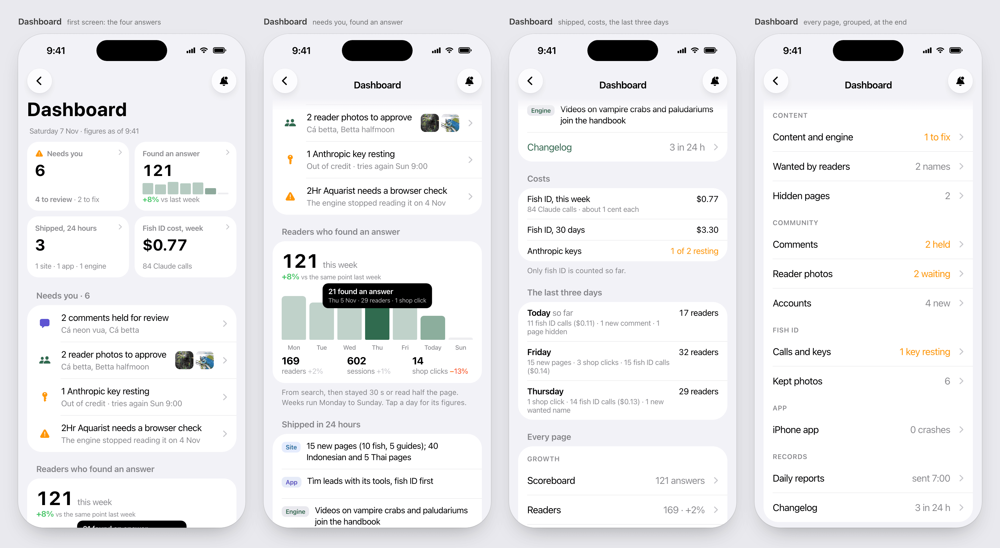
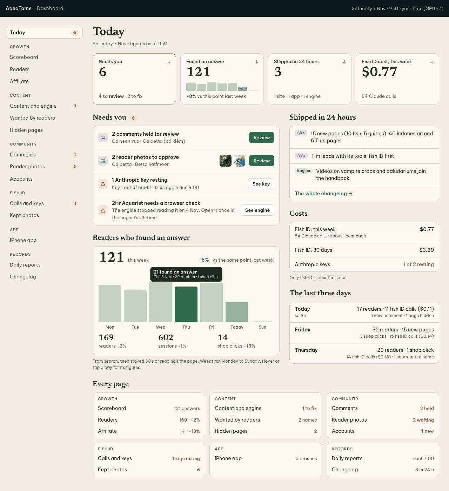
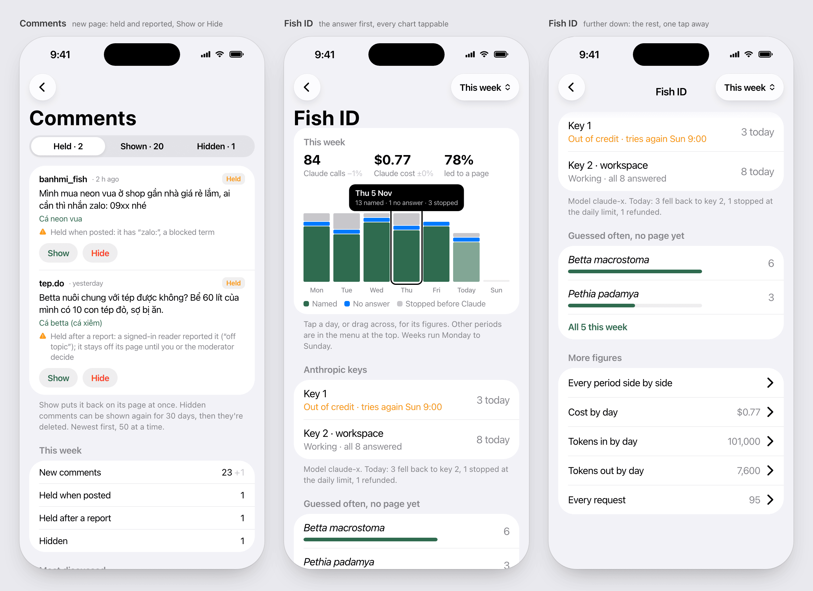
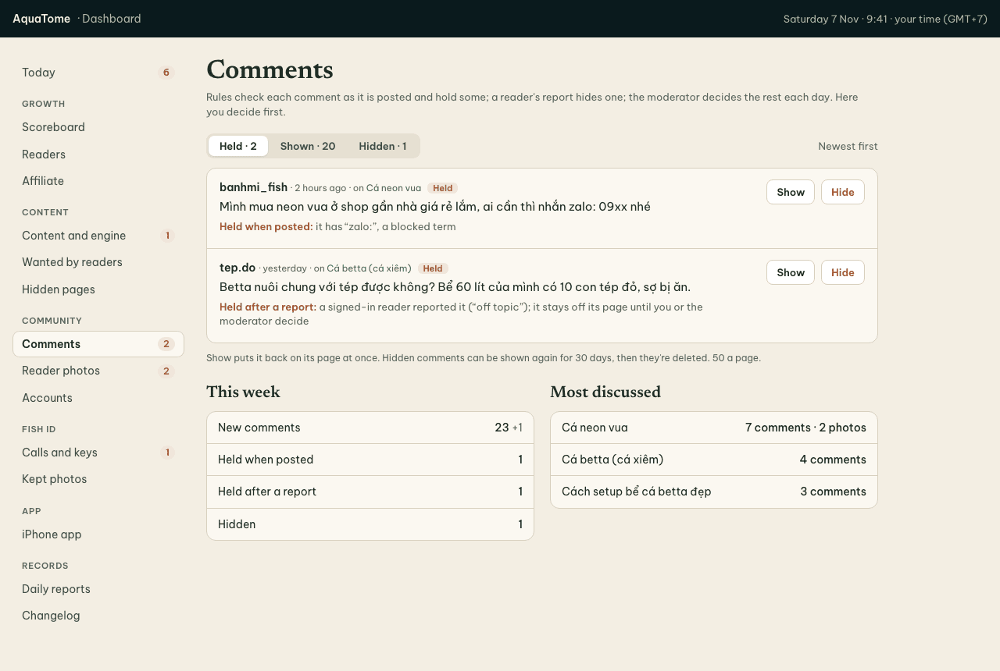
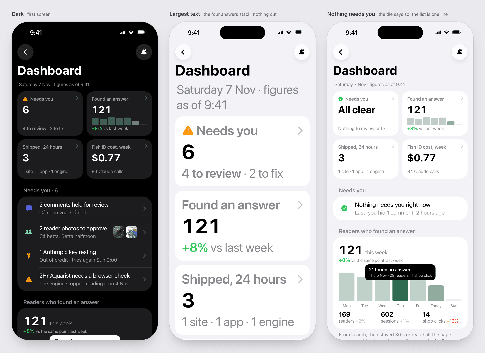
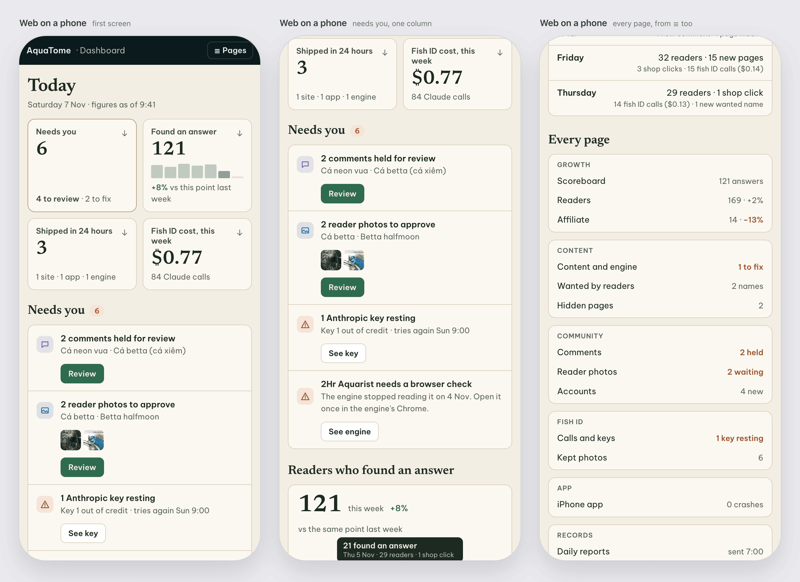

# The owner's dashboard (web and iOS)

Approved by the owner on 2026-11-07. Built by the site lead (the JSON, the server work, the web pages and the daily
report) and the iOS lead (the app's dashboard). The owner's complaints: "very undercooked", and "Charts on mobile...
couldn't get specific number of each bar when touch".

For one reader, the owner, most mornings, often on the phone after the 07:00 report. Two jobs: **know** (are readers
finding answers, what needs me, what shipped, what it costs) and **act** (the few things only the owner decides).

The owner decided:

1. The first screen answers all four as a compact summary, each leading into its detail.
2. The owner reads and hides comments in the dashboard.
3. Same depth on the phone and the web: the same content, laid out for each, not cut down.
4. English for the whole dashboard and the daily report, web and app. The rest of the app and site is unchanged.
5. Every page stays, organised: "Page I haven't opened yet doesn't mean I will not." Usage is measured, not asked.

The mockups' figures are samples that add up to each other; the build shows real ones.

## Pages, grouped

Today (the overview) · **Growth**: Scoreboard, Readers, Affiliate · **Content**: Content and engine, Wanted by
readers, Hidden pages · **Community**: Comments (new), Reader photos, Accounts · **Fish ID**: Calls and keys, Kept
photos · **App**: iPhone app · **Records**: Daily reports, Changelog.

- Every page today keeps its place: the existing 14 plus Comments, whose counts leave Accounts.
- Web: the groups are the rail, with a count badge (rust) only where something waits on the owner.
- App, and the web on a phone: the groups close the overview as "Every page"; on the web the bar's "Pages" menu opens
  the same list.
- The app lists every page. Scoreboard and Changelog are web-only today, outside the app's section list (`NAV`, the
  app's contract); they join it, with Comments.
- **One figure per page, the same on both**: what waits on the owner if anything, else its main figure. Scoreboard
  "121 answers", Readers "169 · +2%", Affiliate "14 · −13%", Content and engine "1 to fix", Wanted by readers
  "2 names", Hidden pages "2", Comments "2 held", Reader photos "2 waiting", Accounts "4 new", Calls and keys "1 key
  resting" (else the week's calls), Kept photos "6", iPhone app "0 crashes", Daily reports "sent 7:00", Changelog
  "3 in 24 h".

## Today

1. **Four tiles**, 2×2 on a phone, one row on the web. Each leads to its part below:
   - **Needs you**: the count, "4 to review · 2 to fix". With nothing: "All clear", "Nothing to review or fix".
   - **Found an answer**: the scoreboard's star figure (from search, then stayed 30 s or read half the page, so never
     more than readers), this week so far against the same point last week, one small bar per day.
   - **Shipped in 24 hours**: the count, "1 site · 1 app · 1 engine".
   - **Fish ID cost, this week**, with its Claude calls. Once the chat agent logs its calls too, "Claude API cost,
     this week", fish ID and chat.
2. **Needs you.** One line each: the thing and its page. The web adds the button that acts (Review, See key, See
   engine). Photo approvals show their thumbnails. With nothing: one line, "Nothing needs you right now", and the
   owner's last action.
3. **Readers who found an answer.** The week's figure and its change, a day chart, then readers, sessions and shop
   clicks with their changes. A week runs Monday to Sunday, as the scoreboard's; days still to come are empty.
4. **Shipped in 24 hours.** The changelog's lines, tagged Site, App or Engine, then the whole changelog.
5. **Costs.** Fish ID (then chat too) this week and over 30 days, and the keys' state. Then the fixed costs as lines,
   not figures: "Engine: Claude subscription, flat", "Cloudflare: fixed plan". The evals' API key isn't counted: its
   spend needs an admin key only the owner can make.
6. **The last three days.** Today's overview lines, kept: readers, fish ID calls and cost, comments, pages.
7. **Every page**, grouped, each with its figure.

The app's bar: back, and a bell for the report's delivery (mail and push on this phone).

## Charts

Every chart, on both, reads a day's figures by touch: tap a bar, or drag across, and a label over it gives the day and
its figures ("21 found an answer · Thu 5 Nov · 29 readers · 1 shop click"); the web shows it on hover too. Today's bar
is lighter (the day isn't over); the chosen bar is the full colour.

A chart's series take chart colours (the app's green, blue, grey; the web's series colours), never orange or red,
which keep their meaning: Fish ID's "No answer" is blue.

## A section page

Its answer first: up to three figures for the chosen period, one chart that can be tapped, then what needs the owner
on that page. The rest folds under named rows that open on tap ("Cost by day", "Every request · 95"). Every figure on
the page is for the period in the bar's menu (this week by default). Long tables show 50 rows at a time.

Fish ID is drawn; every section follows it.

## Comments (new)

The comments table's three states: held, shown (`approved`), hidden (`removed`).

- A filter: Held, Shown, Hidden, each with its count. Held first; newest first, 50 at a time.
- A comment: the name the reader gave, when, its page, the text, and why it is here, in plain English:
  - the posting rules' reasons: "blocked term: zalo:" reads "Held when posted: it has “zalo:”, a blocked term"; also two
    links, "<", a duplicate, more than 5 posts in a day;
  - a signed-in reader's report, which holds a shown comment ("reported by a reader"), reads "Held after a report",
    with the reports' reasons;
  - the moderator's own reason, which it writes in English.
- Held: **Show** and **Hide**. Shown: **Hide**. Hidden: **Show again**, for its 30 days before it is deleted (as
  today).
- The owner's decision sets the reason ("shown by the owner", "hidden by the owner") and `decided_at`, so the
  moderator doesn't take it up again. No new column.
- Below: this week's counts (new, held when posted, held after a report, hidden) and the most discussed pages.

## Look

- App: the app's own inset lists and type, light and dark, every text size. At accessibility sizes the four tiles
  stack one per row and the small bars hide.
- Web: the site's look as today (paper and blackwater, Newsreader figures), light and dark with the system. On a phone
  it is one column, and the rail becomes the bar's "Pages" menu.
- A change is coloured only past 5%: green up, red (rust on the web) down. Otherwise grey.
- Orange (rust on the web) marks what waits on the owner; red is for faults and drops. The server decides each
  figure's colour, so the rule lives in one place.

Dark: `img/dash-phone-dark.png`, `img/dash-sections-dark.png`, `img/dash-web-dark.png`,
`img/dash-web-comments-dark.png`, `img/dash-web-phone-dark.png`.

## The work

**Site lead**:

1. The contract first, with the comment actions' requests and replies (and errors such as "past its 30 days"): the
   overview's new shape (needs, each with its page and action; found an answer by day;
   shipped lines, the changelog's last 24 hours; costs; the last three days; each page's group and figure), the
   Comments section, folded rows and paging, and the app's section list with Scoreboard, Changelog and Comments
   (`NAV`, `protocols/owner-dashboard*.json`).
2. Comments: the owner's list and the actions show, hide, show again (today's moderator path skips `removed`), and the
   English wording of each rule's reason.
3. English for every dashboard page, the overview and the daily report (mail and push).
4. Paging for long tables, 50 rows.
5. Fish ID by period: "This week" (Monday to now) beside today, 7 days, 30 days and the month, against the same point
   last week (the daily rows are whole days, so this needs the calls' times); "led to a page" from the rows' guessed
   and linked; paging past the 100 recent calls.
6. Record each dashboard page open (page, web or app, time) in Analytics Engine. No screen for it yet.
7. The chat agent logs each call as fish ID does, so the tile reads "Claude API cost".

**iOS lead**, once the contract has merged:

1. The overview as drawn: the tiles, Needs you, the chart, the last three days, Every page.
2. Comments: the filter, the rows, the actions, paging.
3. Folded rows that open their table, and paging.
4. English for the dashboard's own words.

Each builder's screenshots (light, dark, the largest text) are checked against these before their PR merges.

## Review

Council (the Anthropic seat only): 6/10, then 8/10, with its last points fixed above. Its findings were mostly
figures that didn't add up (answers above readers, keys against calls, periods mixed on one page) and comment states
the code doesn't have; the spec now follows `comments/api.ts`, `report.ts` and the scoreboard's definitions.
