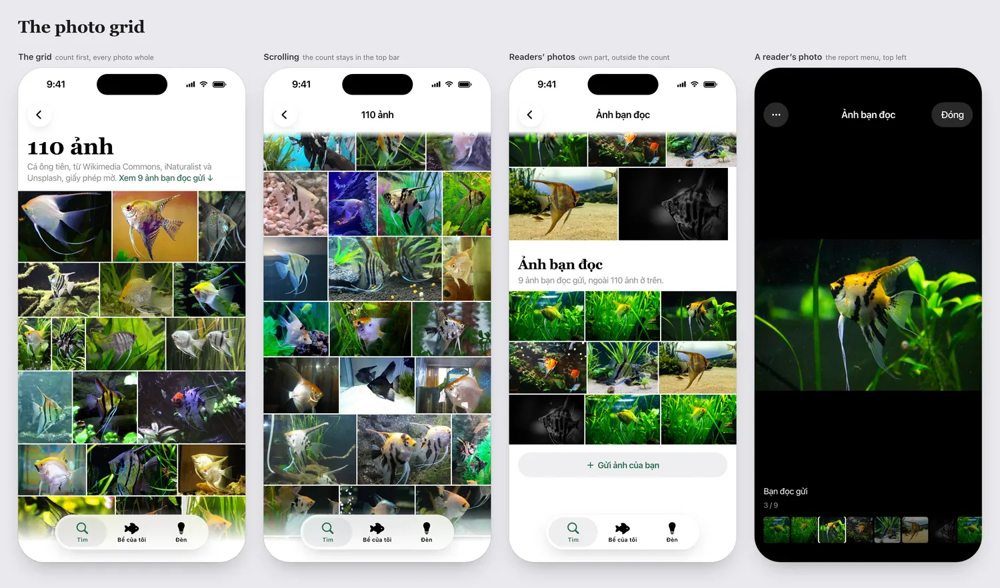
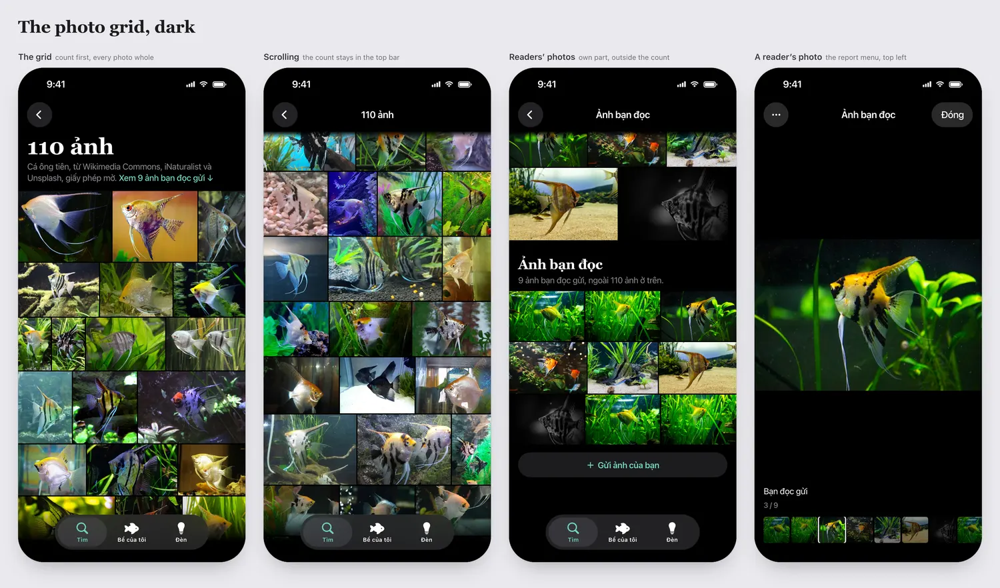

# The photo grid (iOS and site)

Approved by the owner on 2026-11-07: "list all images in gallery in grid as it shows the richness of photo contents".
The iOS content lead builds the app's, the site lead the website's. The v2 fish page opens the same screen.

Readers' photos in the mockups are stand-ins from the gallery, and their count is invented: the page has none yet.

## The app

**Ways in.** Only a page with a gallery has them (a gallery starts at 6 photos, `GALLERY_MIN`):

- The page's "Xem tất cả N ảnh". Today it opens the viewer; it opens the grid instead.
- The lead photo. It carries "N ảnh" in a corner, and the whole photo opens the grid.
- The navigator's Ảnh, in the navigator's own spec.

**The screen.** Pushed in the tab's stack, so the tab bar stays whole. A back button and nothing else in the top bar.

- The count first, as the title: "110 ảnh", serif bold, 40/46.
- Under it, subheadline, secondary: the page's name, then the gallery's note less its count ("Cá ông tiên, từ Wikimedia
  Commons, iNaturalist và Unsplash, giấy phép mở."). With readers' photos, then a link in the tint: "Xem 9 ảnh bạn đọc
  gửi ↓".
- Scrolled past the title, the top bar says "110 ảnh"; once readers' part is in the upper half of the screen, "Ảnh bạn đọc".

**Rows that keep each photo's shape.** Edge to edge, 2 points between photos. Add photos to a row until, stretched to the
screen's width, the row is no taller than 128 points at a 402-point screen (scale with width). The last row doesn't stretch
past that height. Nothing is cropped. On the angelfish page this shows 16 whole photos on the first screen against 9 for
squares, and runs 27% shorter.

**Smooth with hundreds.**

- Every row's size comes from the width and height in the data, before any photo loads, so nothing moves as photos arrive.
- A lazy stack of rows. Each cell loads `thumb`, decoded at the cell's size, with a plain fill until it arrives; loading
  stops for a cell that scrolled away, and the next couple of screens load ahead. A failed thumbnail stays a plain cell.

**Tap.** The existing `GalleryViewer` at that photo, unchanged: full size, swipe, zoom, the words and the credit. Add one
thing: it says which photo it closed on, and the grid scrolls that photo into view if it's off screen.

**Readers' photos.** The same screen, their own part under the gallery, the same rows (their width and height are in the
data). Not in the count, because each can be reported or its sender blocked.

- Heading "Ảnh bạn đọc", then "9 ảnh bạn đọc gửi, ngoài 110 ảnh ở trên."
- A tap opens the viewer with `readers`, which has the report menu, on their own list. Their counter is their own ("3 / 9").
- "Gửi ảnh của bạn" under them, as the page has it today for a reader signed in.
- Their "Xem tất cả" on the page opens this screen at their part. A page with readers' photos and no gallery keeps today's
  row and viewer: no grid.

**Largest text.** The words grow and wrap; the rows stay as they are. **Dark.** The page's black background. **VoiceOver.**
Each photo a button named by its words and its place ("Ảnh 18 trên 110"); the title and "Ảnh bạn đọc" are headings.
**Reduce Motion.** No transition beyond what the viewer already does.

The app's target is iOS 17: nothing here may need a later API without a fallback.

## The website

The `/anh/` page is already a grid. Three changes:

- Its title is the count ("110 ảnh"), first thing on the page, with readers' photos under the grid as today and a link
  down to them.
- It keeps two 4:3 columns on phones: 4:3 barely crops these mostly landscape photos.
- On a fish page's jump row, Ảnh is never dropped. It stays at the row's end with the count ("Ảnh 110") and opens this
  page when the page has a grid.

## The v2 fish page

Its carousel stays. Under it, the same "Xem tất cả N ảnh" opens the same screen, reused from v1: no second grid.
