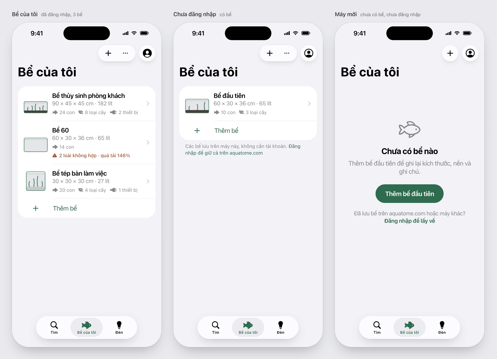
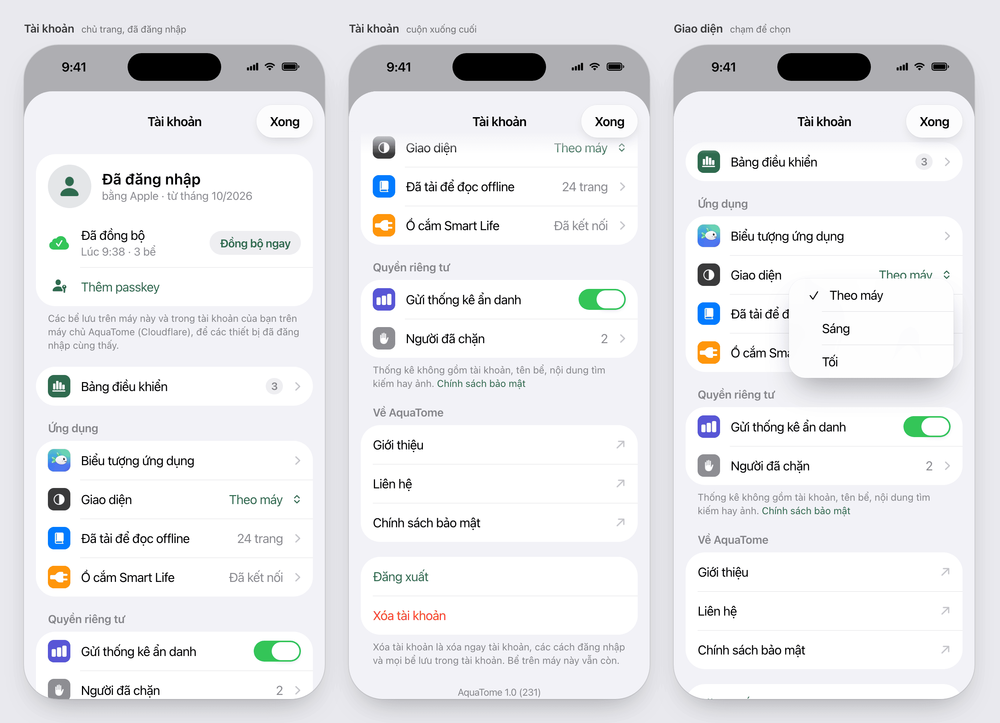
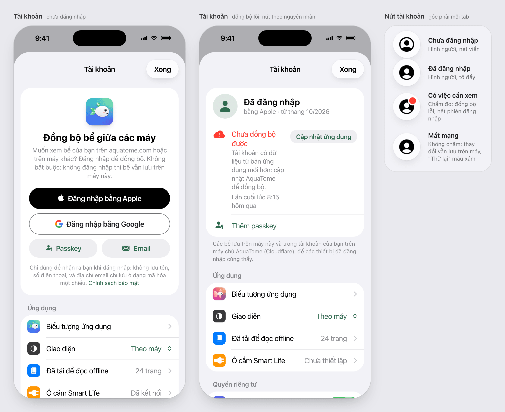
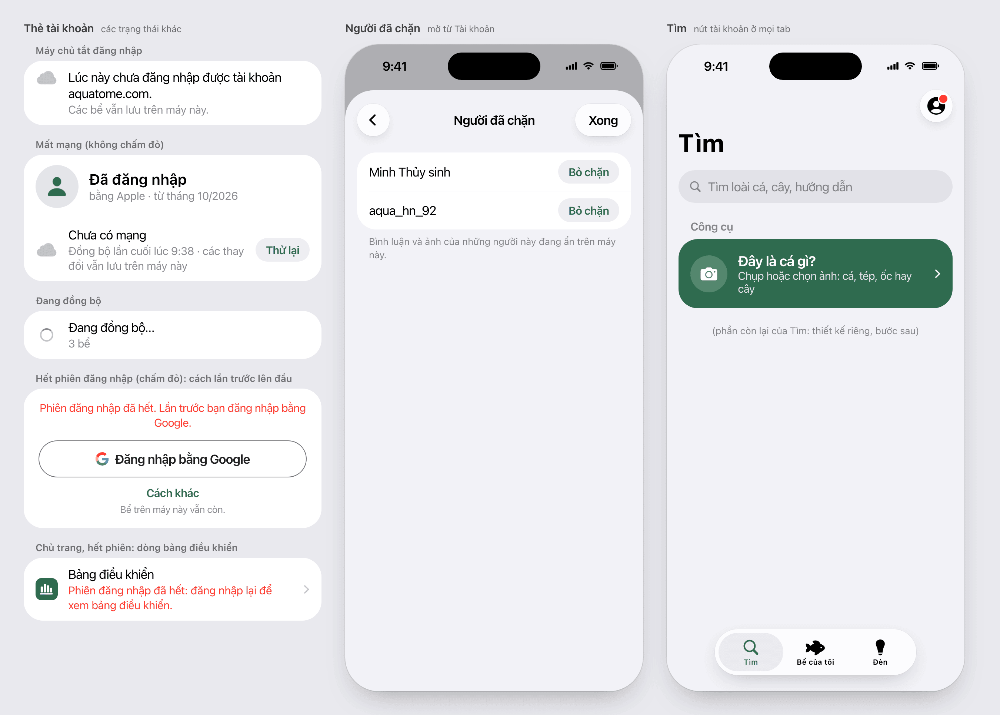
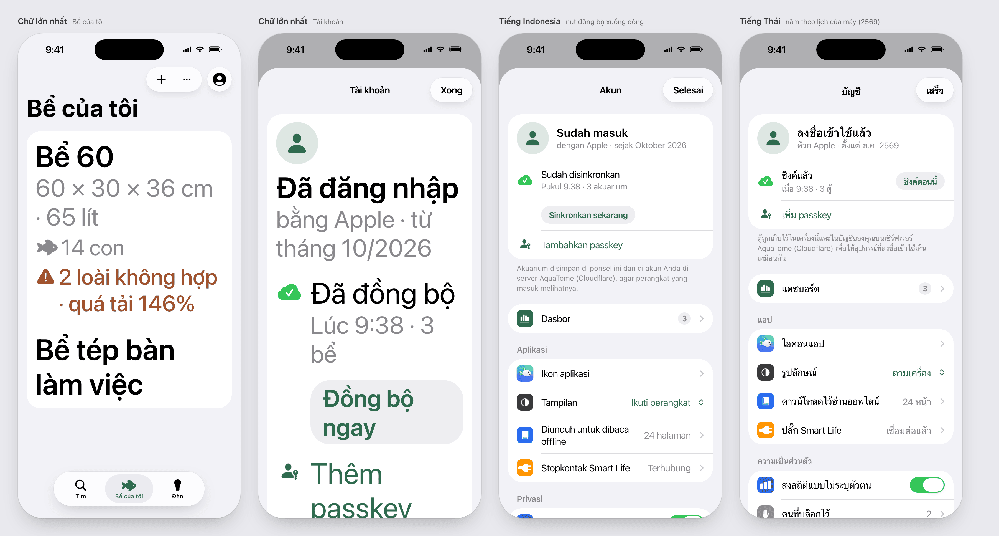

# The account sheet and Bể của tôi (iOS)

Approved by the owner on 2026-11-07, with the appearance setting added. Built by the iOS content lead; the structure
is the navigation brief the owner picked on 2026-11-06: three tabs (Tìm, Bể của tôi, Đèn, later Thiết bị), one account
button, one "Tài khoản" sheet, and Bể của tôi holding tanks only.

## The account button

At the top right of each tab's first screen, its own glass circle, after the tab's other buttons.

- `person.crop.circle` in the label colour signed out; `person.crop.circle.fill` signed in.
- A red dot only for a fault the reader can fix: sync failed, session ended. None while offline: changes stay on the
  phone and nothing is wrong.
- VoiceOver: "Tài khoản", "Tài khoản, đã đăng nhập", "Tài khoản, đồng bộ lỗi".
- Accounts hold no name or email (id, created date and sign-in methods only), so there's no initial or photo.

## The sheet

A sheet at the large detent with "Tài khoản" as its title and "Xong" to close. Inset grouped lists, as the app's
other lists. Row tiles follow iOS Settings: system blue, purple, grey, orange, the app green, dark grey; red only for
faults and deletion.

In order:

1. **Account.**
   - Signed in:
     - The header: an avatar circle, "Đã đăng nhập", and the methods with the created date ("bằng Apple · từ tháng
       10/2026"). The date comes through the system's formatter: a Thai phone shows 2569. The header isn't tappable.
     - The sync row: status, time and tank count, with a small "Đồng bộ ngay" capsule.
     - "Thêm passkey" while the account has none.
     - The storage note (Cloudflare) as the section's footer.
   - Signed out: one card with the app icon, "Đồng bộ bể giữa các máy" and its text. Then Apple and Google, full
     width and equal (Apple's rule), Passkey and Email as two half-width grey buttons, and the fine print with the
     policy link.
2. **Bảng điều khiển**, the owner only, in its own section: the overview's to-do count as a grey badge (red is for
   faults).
3. **Ứng dụng**:
   - Biểu tượng ứng dụng, with the current icon as the row's image.
   - Giao diện: Theo máy (the default), Sáng, Tối, in the system menu. It applies at once, app-wide, and is kept on
     this phone only.
   - Đã tải để đọc offline, with its count: it closes the sheet and opens Tìm's kept shelf.
   - Ổ cắm Smart Life, the Tuya keys: "Đã kết nối" or "Chưa thiết lập". The owner asked on 2026-11-06 for the keys
     "in a settings somewhere", not on each tank. The iOS lead moves them from Bể của tôi when they choose.
4. **Quyền riêng tư**:
   - "Gửi thống kê ẩn danh".
   - "Người đã chặn", only while someone is blocked, with a count. After the last unblock the page says nobody is
     blocked, and the row goes.
   - The footer says what statistics never include, with the policy link.
5. **Về AquaTome**: Giới thiệu, Liên hệ, Chính sách bảo mật, each opening in Safari (`arrow.up.right`).
6. **Đăng xuất** and **Xóa tài khoản** at the very bottom, with the deletion note as the footer, then the version.

## States

- **Sync failed.** A red title, the reason, and the last sync time. The button follows the cause:
  - "Cập nhật ứng dụng" (the App Store) for a store from a newer app;
  - "Thử lại" for network or server faults;
  - none where retrying can't help (account full, records refused).
- **Offline.** "Chưa có mạng", "Đồng bộ lần cuối lúc 9:38 · các thay đổi vẫn lưu trên máy này", a grey "Thử lại", and no
  dot. The app syncs on a change, at launch and by hand, not when the network returns.
- **Session ended.** The sign-in card, with one red line naming the method used last ("Lần trước bạn đăng nhập bằng
  Google") and that method's button first, "Cách khác" under it. A Google user tapping Apple would otherwise make a
  second account.
- **Accounts off.** One row: "Lúc này chưa đăng nhập được tài khoản aquatome.com. Các bể vẫn lưu trên máy này."
- **The owner's session ended.** The dashboard row's red line: "Phiên đăng nhập đã hết: đăng nhập lại để xem bảng
  điều khiển."

## Bể của tôi

Tanks only: the list, "Thêm bể", and the ⋯ menu's JSON export as today.

- Signed in, the list has no footer.
- Signed out with tanks: "Các bể lưu trên máy này, không cần tài khoản." plus a link that opens the sheet.
- A new phone: "Thêm bể đầu tiên" and one link, "Đăng nhập để lấy về", that opens the sheet. No sign-in buttons,
  switches or blocked list on the tab.
- Until the iOS lead moves the plug keys, "Ổ cắm thông minh" stays as the list's last section.

**Tank rows, a later step**, not in the sheet's PR:

- a small drawing of the tank at its length:height, with its substrate and plants;
- the facts line;
- one line of counts (con, loại cây, thiết bị: lights and plugs together);
- a warning that names the problem ("2 loài không hợp · quá tải 146%").

The drawing hides at accessibility text sizes.

## Text sizes and languages

- At accessibility sizes:
  - a row's value moves under its title, and nothing truncates;
  - the header stacks its avatar above the text;
  - capsules move to their own line.
- Indonesian: "Sinkronkan sekarang" drops under the sync status.
- Thai keeps each row's height and wraps the long footers.

Dark: `img/sheet-tanks-dark.png`, `img/sheet-signed-in-dark.png`, `img/sheet-signed-out-dark.png`.

## Review

Council (the Anthropic seat only, the owner's choice until other seats have subscriptions): 7/10, then 8/10 after
its fixes. Its two remaining points were drawing the session-ended state and Indonesian and Thai footers, both done
above.
