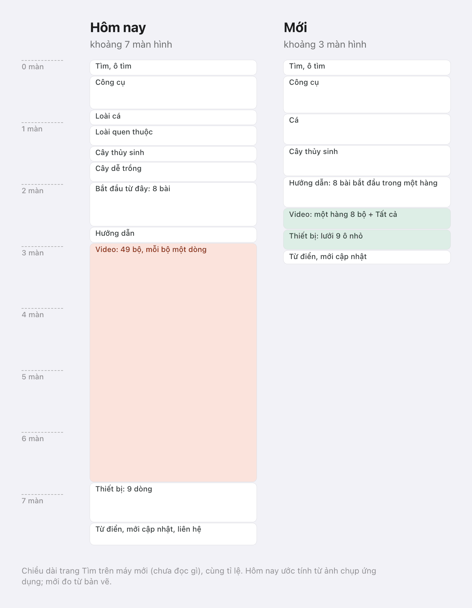
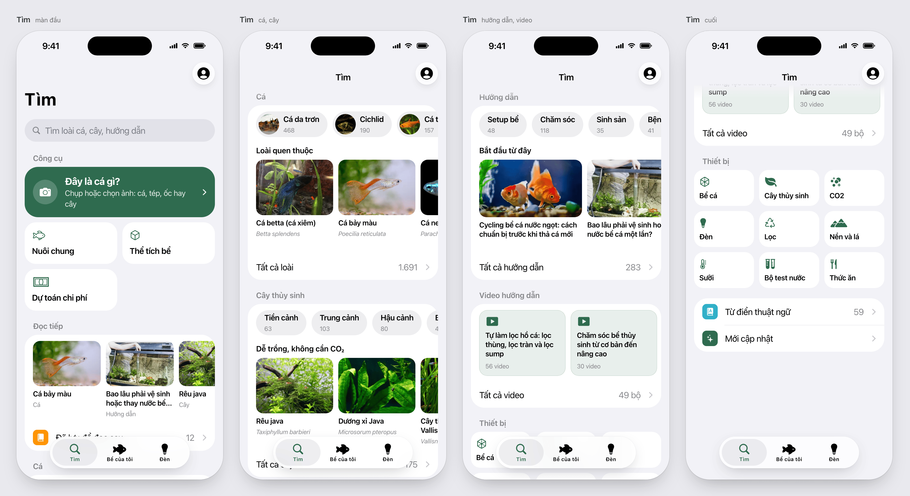
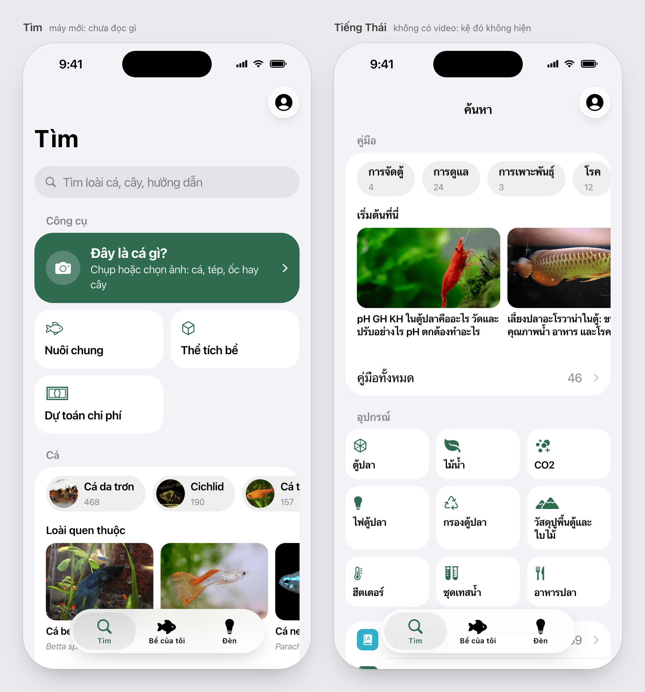

# Tìm, the handbook's home (iOS)

Approved by the owner on 2026-11-07. Built by the iOS content lead. The owner's complaint: "video content is a
longggggg list". Today's page runs about 7 screens on a new phone, 49 video rows of them. This one runs about 3.

## Order

1. The search field.
2. **Công cụ**, as shipped this week: the fish ID card and the tool tiles. Unchanged.
3. **Đọc tiếp**, once something has been read:
   - up to 5 recent pages as one sideways row of small cards (picture, title on 2 lines, kind);
   - then one row, "Đã lưu để đọc sau", with its count.

   On a new phone the section isn't there.
4. **Cá**:
   - the fish group chips, each opening that group's list, as today;
   - the caption "Loài quen thuộc" over the well-known fish cards;
   - "Tất cả loài" with the count.
5. **Cây thủy sinh**: the same pattern, with the placement chips, "Dễ trồng, không cần CO₂" and the easy plants, and
   "Tất cả cây".
6. **Hướng dẫn**:
   - the subject chips;
   - "Bắt đầu từ đây": all 8 starter guides as one sideways row of cards (picture, title on 3 lines), so a beginner
     reaches each;
   - "Tất cả hướng dẫn".
7. **Video hướng dẫn**: one sideways row of 8 series cards, then "Tất cả video · 49 bộ" (one number, matching its
   label).
   - Each card is tinted, with a play symbol, the title on 3 lines and the video count ("56 video").
   - No thumbnails for now: YouTube's show faces, hands and channel logos, which the photo rules ban
     (docs/governance.md, Photos). They can come back once thumbnails pass the same checks as page photos.
   - No channel name on a card: it stays on the series page, as its credit.
8. **Thiết bị**: a 3×3 grid of small tiles, each a symbol and a name. The index's photos for these don't show the kit.
9. One closing card: Từ điển thuật ngữ (with its count) and Mới cập nhật. Liên hệ leaves Tìm: it is in the account
   sheet's "Về AquaTome".

## Rules

- **One shelf pattern.** A header, then a chip row that browses, a named row of picks, and "Tất cả … N". With
  nothing more to show, there's no "Tất cả".
- **A shelf with no items isn't drawn.** Indonesian and Thai have no videos, so that shelf is absent there.
- **At accessibility text sizes:**
  - a chip row becomes one row ("Nhóm cá · 14") that opens the list;
  - a pick row becomes 3 list rows plus "Tất cả";
  - the 3×3 grid becomes a list.
- **The account button** sits at the top right (docs/design/profile-sheet.md).

Dark: `img/tim-dark.png`.

## Review

Council (the Anthropic seat only): 7/10 before its fixes, which are above:

- the pick captions are back;
- all 8 starter guides are reachable;
- video cards have no thumbnails, and their "Tất cả" row has one count;
- equipment uses symbols;
- a new phone, Thai and dark are drawn.

One point not taken: hiding the chips behind "Tất cả". They are the expert's way in (14 fish groups) and cost one
short row.
