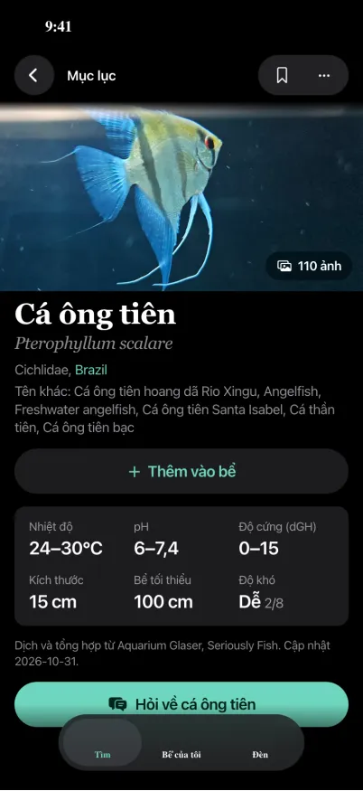
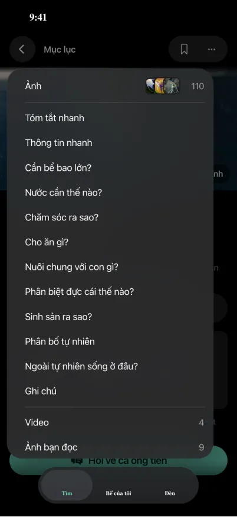
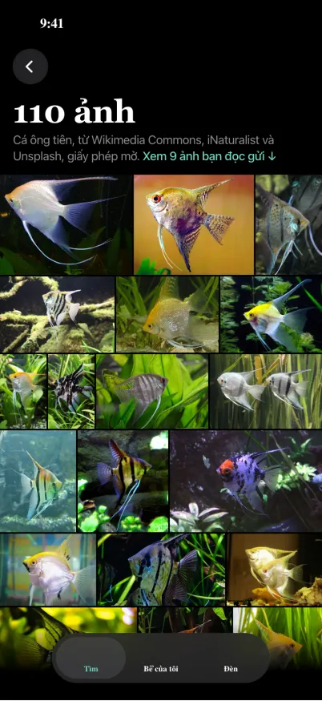
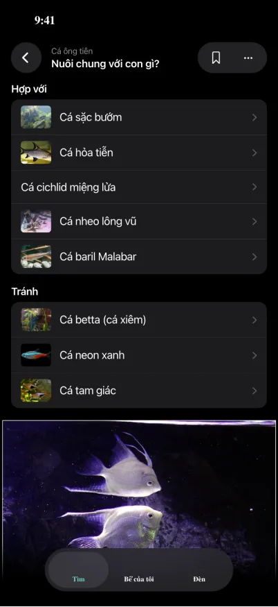

# v2's fish page (iOS)

The owner chose this on 2026-11-09, from the four screens below. The v2 Lab builds it in the whole-page PR (#921), with
the iOS content lead's photo grid (#760, [photo-grid.md](photo-grid.md)). The chat entry comes with the chat
([chat.md](chat.md)). Before the owner gets a build, the design lead records the betta's page and sets the recording
beside these four screens.

The screens are drawn on v1's look. v2 keeps its own in three places: the banner runs under the bar, the bar has share where
the screens have ⋯, and the tab bar is v2's. The owner agreed to all three.

## From the top

1. **Banner.** This is the page's main photo.
   - On a page with a gallery (6 photos or more), "N ảnh" sits in the bottom right corner: 12 points from the edges,
     32 tall, fully rounded, black at 46% with a blur, white 14 semibold, after a photo icon.
   - A tap anywhere on the photo opens the photo grid. With fewer photos there's no badge, and the tap does what it does
     today.
2. **Name.** In order:
   - the name;
   - the Latin name, in italics;
   - family and origin on one line ("Cichlidae, Brazil"), the origin a link to its page;
   - the other names ("Tên khác: …").

   They come from the page's `title`, `sub`, `where` and `aka`. Body size, secondary, as in the first screen.
3. **"Thêm vào bể"**, as v2 has it today.
4. **"Hỏi về cá <name>"**, directly under "Thêm vào bể": the owner's pick (2026-11-09). The mock's code and the picture above
   have it after the facts card.
   - Full width, tint fill, the chat icon, and "Trả lời dựa trên cẩm nang AquaTome" centred under it (13, secondary; the chat's own line, which the
     editors read, where the screens have an older one).
   - It shows only while chat is on, which for now means the owner's account alone. It opens the chat about this fish.
   - Whichever of #921 and the chat screen's PR (#765) lands second puts it in.
5. **Facts card.** The first screen's card replaces v2's row of figures.
   - Two rows of three: Nhiệt độ, pH and Độ cứng (dGH), then Kích thước, Bể tối thiểu and Độ khó ("Dễ 2/8", the
     "2/8" smaller).
   - Each is a label (13, secondary) over its figure (20 semibold). The card is a rounded fill, corners 12.
   - At the largest text it becomes one column.
   - No line about its sources or when it was updated: the owner said no.
6. **Photos.** v2's one-row carousel, before any of the text.
   - A photo opens the viewer at that photo.
   - Its last tile, "Xem tất cả N ảnh", opens the grid.
7. **The page's parts**, in #921's order, a long one folding under "thêm".
   - The row of chips above them (Nuôi chung, Nước, Cho ăn, Sinh sản) stays for readers and is hidden for whoever has the
     page's title below. It goes for everyone when the title opens to everyone.
8. **Tank-mates.** The list rows of the fourth screen replace v2's shelves.
   - Two groups, "Hợp với" and "Tránh", each a rounded list.
   - A row is the fish's photo (44 × 33, corners 5) and its name, with a line under it where the page gives one, then a
     chevron.
   - A fish with no photo shows its name alone. A tap opens that fish's page.
   - The tank-mates tool's link and the photos' credits follow, as today.

## The page's title (the owner's account, until the owner says it ships)

On a page with at least 4 parts and 3 screens of the folded page. Anyone else, or a shorter page, sees v2's bar as today.

- **At the top:** "Mục lục", left-aligned beside the back button, 15 semibold, with a small chevron: white on the photo, where the tint goes faint on a pale one, and the tint everywhere else. The shade behind the bar holds through it, so the word and the chevron read at 3:1 on the brightest photo.
  - It's plain text, not a capsule. Over the photo it sits on v2's shade. If white falls under 3:1 there, it gets a
    soft shadow.
- **Scrolled:** once the name has gone under the bar, the bar shows two lines in the same place:
  - the name, 12, secondary;
  - under it, the part being read, 15 semibold.

  Each line is cut short at one line. At the largest text, the part alone shows, at 22.
- **The list:** a tap drops a panel from under the bar.
  - It sits 12 points from the left edge and 40 from the right, with corners 26, and the page is dimmed behind it. A tap
    outside closes it.
  - **"Ảnh"** comes first: three 26-point thumbnails with corners 6, overlapping, then the count. It **opens the grid**.
  - A separator, then the care parts, then another separator, then the rest. "Video" and "Ảnh bạn đọc" carry their counts.
  - The part being read is marked.
  - A part chosen comes to rest with its heading just under the bar, and opens if it was folded.
- **Spoken label:** "Mục lục, đang ở <part>". With VoiceOver on, nothing folds.
- **No rail, and no ⋯ menu to turn it on.** The owner tried both on 2026-11-09 and took them out.

## What to Test (for the build that brings it)

Owner only:
1. Open the Khám phá tab, search "betta", and open Cá betta (cá xiêm).
2. Tap the big photo: every photo opens as a grid. Go back.
3. Under the name: family, origin, other names, "Thêm vào bể", then "Hỏi về cá betta" (once chat is on for you).
4. Scroll down: the title at the top names the part you're reading. Tap it, then tap Ảnh for the grid, or a part to go
   there.

The taps are checked against the build before it goes out.
